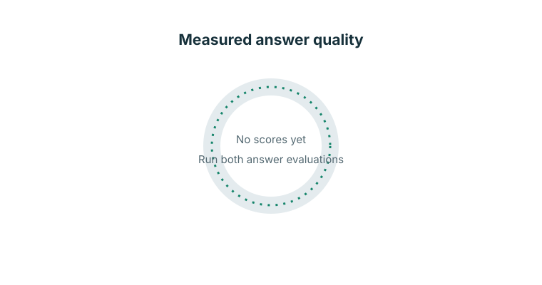

# RAG with Evaluation Harness

A reproducible retrieval-augmented generation (RAG) experiment over a pinned subset of the public GitLab handbook. It includes four chunking strategies, exact cosine-vector/BM25/hybrid retrieval, optional reranking, passage-level metrics, an experiment grid, answer/judge scripts, and regression-checking CI.

> **Benchmark status:** the pinned handbook snapshot has been fetched and cleaned (515 documents). The reviewed main/dev question sets and model-backed answer runs have not been created, so no retrieval accuracy, answer-quality, or latency results are claimed. Complete the benchmark steps below before treating the default setup as a winning configuration.

## Setup

Use Python 3.11 or newer and Git. Install the pinned packages:

```powershell
py -m venv .venv
.\.venv\Scripts\Activate.ps1
python -m pip install -r requirements.txt
```

The pinned subset in `data/clean/` has 515 cleaned Markdown files from source revision `539e7d1d7e05c89dde7b20dfeb59ed968349c800`. Its source repository license does not clearly specify a separate license for handbook text; confirm redistribution rights before publishing or sharing the corpus. Source attribution and revision are recorded in `data/ATTRIBUTION.txt`.

To reproduce the subset from the upstream source, fetch it and clean it:

```powershell
python src\fetch_data.py
python src\clean.py
```

Inspect the cleaned documents under `data/clean/`. The first fetch records its source commit in `data/DATA_VERSION.txt`; subsequent fetches use that revision. Review the handbook's current license and retain its attribution when publishing.

## Build and evaluate

1. Write `data/testset_main_src.json` with 50 reviewed questions (20 direct, 12 paraphrased, 8 multi-document, 10 no-answer) and `data/testset_dev_src.json` with at least 100 reviewed questions. For answerable questions, copy exact passage text from `data/clean/`; positions are computed by the build script. Do not tune against the main set.
2. Build the offset-bearing test sets and run the offline tests:

   ```powershell
   python src\build_testset.py
   pytest -q
   ```

3. Build local model indexes and run the 24-setup dev grid:

   ```powershell
   python src\index.py
   python src\run_grid.py
   ```

   Results are written to `results/grid.csv`. Choose `config/best.json` from dev evidence, then run `python src/ci_check.py --baseline results/baseline_perq.json --update` once to establish a reviewed baseline.
   To build a single index first, pass `--chunker heading` (or `fixed500`, `fixed1000`, or `semantic`).
4. Run `python src\run_headline.py` for the four final methods on the main set. Run the main set at most twice: before fixes and after fixes; use only the dev set to choose changes.

## Answers and control

The answer and judge APIs must be OpenAI-compatible. Copy `.env.example` to `.env` and set `RAG_ANSWER_API_KEY`, `RAG_ANSWER_MODEL`, `RAG_JUDGE_API_KEY`, and `RAG_JUDGE_MODEL`. Use different models for answering and judging. `.env` is loaded locally and ignored by Git; do not commit keys.

```powershell
python src\run_answers.py --control
python src\run_answers.py
```

The RAG run writes per-question output to `results/answers_main.csv`; the no-retrieval control is saved separately to `results/answers_control.csv`. The answerable-question retrieval baseline does not use an LLM, and CI requires no API credentials. To report no-answer threshold trade-offs after selecting a reranked setup, run `python src\calibrate_threshold.py`.

## Project map: why each file exists

### Folders

| Folder | Goal |
|---|---|
| `config/` | Select the retrieval setup used by the final run and CI. |
| `data/raw/` | Hold the reproducibly selected upstream Markdown snapshot. |
| `data/clean/` | Hold cleaned source text; this is the text used for chunks and exact passage offsets. |
| `src/` | Hold the ingestion, retrieval, generation, evaluation, and chart code. |
| `tests/` | Protect core pipeline behavior and validate reviewed test sets. |
| `results/` | Hold actual experiment outputs and the README answer-quality chart. |
| `.github/workflows/` | Run unit and (when benchmark inputs exist) retrieval-regression checks. |

### Root files

| File | Goal |
|---|---|
| `README.md` | Explain setup, experiment workflow, limitations, and measured project outcomes. |
| `DECISIONS.md` | Record implementation choices and real experimental evidence without inventing results. |
| `requirements.txt` | Pin the Python dependencies for reproducible setup. |
| `pytest.ini` | Configure pytest to find the `src` modules and tests. |
| `Makefile` | Provide shortcuts for data, index, tests, and evaluation tasks. |
| `Dockerfile` / `.dockerignore` | Build a container while excluding local caches, credentials, and the full source clone. |
| `.gitignore` | Keep secrets, environments, temporary indexes, and unreviewed output out of source control. |
| `.env.example` | Show the names of optional answer/judge settings without storing credentials. |
| `config/best.json` | Select the current candidate configuration; it is not claimed to be a measured winner yet. |
| `data/ATTRIBUTION.txt` | Record handbook provenance and the need to check content redistribution terms. |

See [`src/README.md`](src/README.md), [`data/README.md`](data/README.md), [`config/README.md`](config/README.md), [`tests/README.md`](tests/README.md), and [`results/README.md`](results/README.md) for per-file responsibilities and generated outputs. Each directory README explains what its files are for; `src/README.md` lists every project script.

## Final output chart

The circle chart below compares answers judged correct with and without retrieval. It is deliberately a placeholder until the reviewed benchmark and both answer runs exist—no scores are being guessed. After completing the evaluations, generate it from the CSV outputs:

```powershell
python src\plot_results.py
```

The script checks that both files contain the same question IDs and uses their measured `correct` values.



## Git history

This workspace did not have a Git repository when work began. I have not created a staged history or invented issue/fix commits. For a credible portfolio, keep a real Git history as changes are actually made, and describe each commit's real motivation, change, and test evidence. Do not present reconstructed or fabricated milestones as historical work.

## Limitations and attribution

The intended benchmark has 50 main questions from one handbook subset; it does not establish general performance. The handbook may have appeared in model training data. A no-retrieval control is required to interpret generated answer scores, and small differences may be noise. The source is the [GitLab Handbook](https://handbook.gitlab.com/); check and follow the license terms of the exact pinned revision before redistributing its cleaned content.
