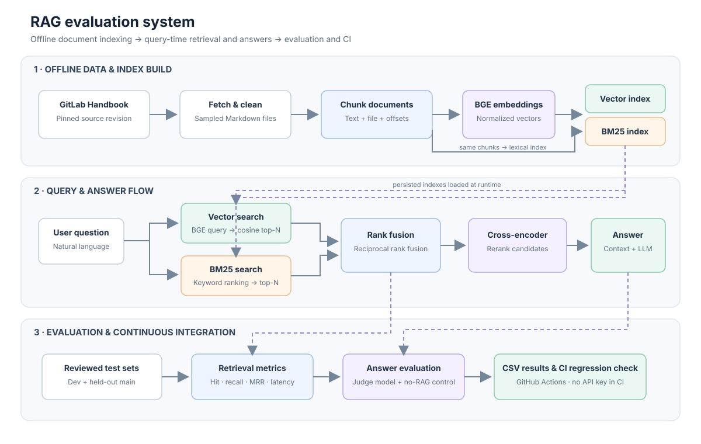

# RAG with Evaluation Harness

A reproducible retrieval-augmented generation (RAG) experiment over a pinned subset of the public GitLab handbook. It includes four chunking strategies, exact cosine-vector/BM25/hybrid retrieval, optional reranking, passage-level metrics, an experiment grid, answer/judge scripts, and regression-checking CI.

> **Benchmark status:** the pinned handbook snapshot has been fetched and cleaned (515 documents). The reviewed main/dev question sets and model-backed answer runs have not been created, so no retrieval accuracy, answer-quality, or latency results are claimed. Complete the benchmark steps below before treating the default setup as a winning configuration.

## Setup

Use Python 3.11 or newer and Git. Install the pinned packages:

```powershell
py -m venv .venv
.\.venv\Scripts\Activate.ps1
python -m pip install -r requirements.txt
```

The pinned subset in `data/clean/` has 515 cleaned Markdown files from source revision `539e7d1d7e05c89dde7b20dfeb59ed968349c800`. Its source repository license does not clearly specify a separate license for handbook text; confirm redistribution rights before publishing or sharing the corpus. Source attribution and revision are recorded in `data/ATTRIBUTION.txt`.

To reproduce the subset from the upstream source, fetch it and clean it:

```powershell
python src\fetch_data.py
python src\clean.py
```

Inspect the cleaned documents under `data/clean/`. The first fetch records its source commit in `data/DATA_VERSION.txt`; subsequent fetches use that revision. Review the handbook's current license and retain its attribution when publishing.

## Build and evaluate

1. Write `data/testset_main_src.json` with 50 reviewed questions (20 direct, 12 paraphrased, 8 multi-document, 10 no-answer) and `data/testset_dev_src.json` with at least 100 reviewed questions. For answerable questions, copy exact passage text from `data/clean/`; positions are computed by the build script. Do not tune against the main set.
2. Build the offset-bearing test sets and run the offline tests:

   ```powershell
   python src\build_testset.py
   pytest -q
   ```

3. Build local model indexes and run the 24-setup dev grid:

   ```powershell
   python src\index.py
   python src\run_grid.py
   ```

   Results are written to `results/grid.csv`. Choose `config/best.json` from dev evidence, then run `python src/ci_check.py --baseline results/baseline_perq.json --update` once to establish a reviewed baseline.
   To build a single index first, pass `--chunker heading` (or `fixed500`, `fixed1000`, or `semantic`).
4. Run `python src\run_headline.py` for the four final methods on the main set. Run the main set at most twice: before fixes and after fixes; use only the dev set to choose changes.

## Answers and control

The answer and judge APIs must be OpenAI-compatible. Copy `.env.example` to `.env` and set `RAG_ANSWER_API_KEY`, `RAG_ANSWER_MODEL`, `RAG_JUDGE_API_KEY`, and `RAG_JUDGE_MODEL`. Use different models for answering and judging. `.env` is loaded locally and ignored by Git; do not commit keys.

```powershell
python src\run_answers.py --control
python src\run_answers.py
```

The RAG run writes per-question output to `results/answers_main.csv`; the no-retrieval control is saved separately to `results/answers_control.csv`. The answerable-question retrieval baseline does not use an LLM, and CI requires no API credentials. To report no-answer threshold trade-offs after selecting a reranked setup, run `python src\calibrate_threshold.py`.

## Project map: why each file exists

### Folders

| Folder | Goal |
|---|---|
| `config/` | Select the retrieval setup used by the final run and CI. |
| `data/raw/` | Hold the reproducibly selected upstream Markdown snapshot. |
| `data/clean/` | Hold cleaned source text; this is the text used for chunks and exact passage offsets. |
| `src/` | Hold the ingestion, retrieval, generation, evaluation, and chart code. |
| `tests/` | Protect core pipeline behavior and validate reviewed test sets. |
| `results/` | Hold actual experiment outputs and the README answer-quality chart. |
| `.github/workflows/` | Run unit and (when benchmark inputs exist) retrieval-regression checks. |

### Root files

| File | Goal |
|---|---|
| `README.md` | Explain setup, experiment workflow, limitations, and measured project outcomes. |
| `DECISIONS.md` | Record implementation choices and real experimental evidence without inventing results. |
| `requirements.txt` | Pin the Python dependencies for reproducible setup. |
| `pytest.ini` | Configure pytest to find the `src` modules and tests. |
| `Makefile` | Provide shortcuts for data, index, tests, and evaluation tasks. |
| `Dockerfile` / `.dockerignore` | Build a container while excluding local caches, credentials, and the full source clone. |
| `.gitignore` | Keep secrets, environments, temporary indexes, and unreviewed output out of source control. |
| `.env.example` | Show the names of optional answer/judge settings without storing credentials. |
| `config/best.json` | Select the current candidate configuration; it is not claimed to be a measured winner yet. |
| `data/ATTRIBUTION.txt` | Record handbook provenance and the need to check content redistribution terms. |

See [`src/README.md`](src/README.md), [`data/README.md`](data/README.md), [`config/README.md`](config/README.md), [`tests/README.md`](tests/README.md), and [`results/README.md`](results/README.md) for per-file responsibilities and generated outputs. Each directory README explains what its files are for; `src/README.md` lists every project script.

## Architecture

The pipeline runs as a local batch workload. It does not expose a hosted HTTP API.



| Area | Flow |
|---|---|
| Offline indexing | Handbook → fetch/clean → chunk with source offsets → BGE embeddings → vector index and BM25 index. |
| Query and answer | Question → vector + BM25 search → reciprocal-rank fusion → cross-encoder reranking → context-grounded answer. |
| Evaluation and CI | Reviewed test sets → retrieval metrics and answer/control evaluation → CSV results → GitHub Actions regression check. |

## Deployment and repeatable runs

This is a **batch evaluation project**, not a continuously running website. “Deploy” means building its container and running the evaluation pipeline on a machine or CI runner. A hosted `/ask` endpoint is not implemented.

### A. Prepare and validate the inputs

1. Install Git, Python 3.11+, and Docker Desktop (Windows/macOS) or Docker Engine (Linux). Clone your GitHub repository and open its root folder.
2. Set up Python and run the offline tests:

   ```powershell
   py -m venv .venv
   .\.venv\Scripts\Activate.ps1
   python -m pip install -r requirements.txt
   python -m pytest -q
   ```

3. Before publishing handbook text, review `data/ATTRIBUTION.txt` and confirm the content redistribution terms. The handbook corpus is currently in `data/clean/`; the full clone is local and ignored by Git.
4. Create `data/testset_main_src.json` and `data/testset_dev_src.json` with human-reviewed questions and exact passages copied from the cleaned files. Build and verify the positional sets:

   ```powershell
   python src\build_testset.py
   python -m pytest -q
   ```

   The test-set tests remain skipped until both generated sets exist and have the expected reviewed shape.

### B. Build and run the evaluation container

5. Build the image from the project root. This installs the pinned Python dependencies and downloads the embedding and reranking models into the image:

   ```powershell
   docker build -t rag-eval:local .
   ```

   Expect a large image and an initial download. Rebuild when dependencies or model configuration change.
6. Create host directories for persistent indexes and output files, then build the indexes. Keeping these as bind mounts means the files survive after the one-shot container exits:

   ```powershell
   New-Item -ItemType Directory -Force .cache, results | Out-Null
   docker run --rm `
     --mount "type=bind,source=$((Resolve-Path .cache).Path),target=/app/.cache" `
     --mount "type=bind,source=$((Resolve-Path results).Path),target=/app/results" `
     rag-eval:local
   ```

7. Run the dev experiment grid using the indexes created in the previous step:

   ```powershell
   docker run --rm `
     --mount "type=bind,source=$((Resolve-Path .cache).Path),target=/app/.cache" `
     --mount "type=bind,source=$((Resolve-Path results).Path),target=/app/results" `
     rag-eval:local python src/run_grid.py
   ```

8. Select `config/best.json` from dev evidence, run the held-out main comparison as prescribed, and save a reviewed regression baseline:

   ```powershell
   docker run --rm `
     --mount "type=bind,source=$((Resolve-Path .cache).Path),target=/app/.cache" `
     --mount "type=bind,source=$((Resolve-Path results).Path),target=/app/results" `
     rag-eval:local python src/ci_check.py --baseline results/baseline_perq.json --update
   ```

   Record the measured outcomes in `DECISIONS.md`. Do not describe the initial `best.json` as a measured winner before comparing the dev grid.

### C. Optional answer-model evaluation

9. Copy `.env.example` to `.env`; configure distinct OpenAI-compatible answer and judge models. Keep `.env` private. Do not bake credentials into the Docker image or commit them. Pass the file only to the run that needs it:

   ```powershell
   docker run --rm --env-file .env `
     --mount "type=bind,source=$((Resolve-Path .cache).Path),target=/app/.cache" `
     --mount "type=bind,source=$((Resolve-Path results).Path),target=/app/results" `
     rag-eval:local python src/run_answers.py --control

   docker run --rm --env-file .env `
     --mount "type=bind,source=$((Resolve-Path .cache).Path),target=/app/.cache" `
     --mount "type=bind,source=$((Resolve-Path results).Path),target=/app/results" `
     rag-eval:local python src/run_answers.py
   ```

   The control run and RAG run produce separate CSVs. Check API-provider billing and review answers before using the scores.
### D. Enable GitHub Actions deployment checks

11. Create an empty GitHub repository, then from the local project root publish the current branch (replace the URL with your repository):

   ```powershell
   git init
   git add .github config docs src tests data/README.md data/ATTRIBUTION.txt data/DATA_VERSION.txt results/README.md README.md DECISIONS.md Dockerfile .dockerignore Makefile pytest.ini requirements.txt .env.example .gitignore
   git commit -m "Build RAG evaluation pipeline and deployment docs"
   git branch -M main
   git remote add origin https://github.com/<your-user>/<your-repository>.git
   git push -u origin main
   ```

   The staging command deliberately excludes handbook content, generated test sets, local caches, and `.env`. Only after confirming redistribution terms, add the approved corpus and reviewed benchmark files explicitly (for example `git add data/clean data/titles.json data/testset_main.json data/testset_dev.json results/baseline_perq.json`). Keep API credentials out of Git in all cases. Without the required benchmark inputs, GitHub Actions runs unit tests and reports the retrieval benchmark as skipped.
12. In the GitHub repository, open **Settings → Actions → General** and allow the repository's workflows to run. The workflow at `.github/workflows/eval.yml` automatically runs unit tests for pushes to `main` and pull requests.
13. The workflow enables index building and retrieval-regression checks only when the cleaned corpus, generated main test set, and reviewed baseline are committed and present. CI does not need LLM API keys and does not run answer generation.
14. Open a pull request and confirm the `rag-eval` workflow passes. If retrieval inputs are missing, the workflow reports that the retrieval benchmark was skipped; this is not evidence that the retrieval benchmark passed.

For Linux/macOS, substitute shell-appropriate virtual-environment activation and bind-mount paths. For an always-on API deployment, first implement and test an API server; the current Docker image is a finite CLI job and exits when its command finishes.

## Results

**Status: pending evaluation.** The handbook corpus is prepared, but reviewed main/dev question sets and model-backed answer runs have not been completed. No retrieval or answer-quality scores are claimed.

| Evaluation | Result | Output |
|---|---:|---|
| Main-set answer quality without retrieval | Pending | `results/answers_control.csv` |
| Main-set answer quality with RAG | Pending | `results/answers_main.csv` |
| Retrieval setup comparison (24 combinations) | Pending | `results/grid.csv` |
| Headline retrieval methods | Pending | `results/headline.csv` |
| Missed-question analysis | Pending | `results/failures.csv` |

After running the evaluations, replace “Pending” with measured counts (for example, `correct answers / evaluated questions`) and summarize the important trade-offs in [`DECISIONS.md`](DECISIONS.md). Do not report unrun experiments as results.


