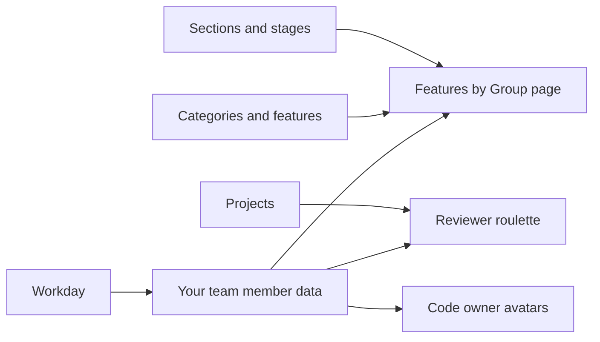

This page covers how to review and update your team member data entry (your YAML file in the
[www-gitlab-com project](https://gitlab.com/gitlab-com/www-gitlab-com)) and how to add your pets to the Team Pets page.

For the handbook, see the [editing handbook page](/handbook/about/editing-handbook/).

The Workday sync creates and updates your team member data entry daily. For example, the
[Features by Group](/handbook/product/categories/features/) page lists every product group with its product manager,
engineering manager, and other counterparts. It finds these people through their team member data, so a wrong name or
GitLab username leaves you out of your group. See [How your entry connects to other data](#how-your-entry-connects-to-other-data).

Product and Engineering workflows that depend on your entry:

- **Reviewer roulette** suggests reviewers and maintainers from your `gitlab` username and `projects` roles.
- **Code owner reviews:** handbook pages resolve CODEOWNERS users by `gitlab` username, to show the name and picture
  of the page maintainers.
- **DRI listings:** handbook pages such as stable counterparts, stage and group tables, and technical writing
  assignments list team members by `name`, `role`, and `reports_to`.
- **Community contribution labels:** if `gitlab` does not match the GitLab account you use for work, your merge
  requests are labeled as community contributions.

Keep these fields current. Profile details such as `story`, `remote_story`, and social handles are optional.
For current work on the team data sync, see the
[FY27 team data sync epic](https://gitlab.com/groups/gitlab-com/people-group/-/work_items/118).

## Review and update your entry {#add-yourself-to-the-team-page}

A [sync](https://theloop.gitlab.com/site/4455aa7f-24d9-41f2-b940-467b54962e4d/page/0fa19bf4-fd6a-41b9-9316-c2dcf3add854) adds a basic team member data entry for you on your third day of employment at GitLab. Review it and add information to it. If an update is not properly reflected, verify that your Workday setting is correct. All of the available fields are documented in the [team member data schema](https://gitlab.com/gitlab-com/www-gitlab-com/-/blob/master/data/team_members/person/README.md).

If your entry shows a wrong name or GitLab username, [update your team data settings in Workday](#update-your-team-data-settings-in-workday).

### Choose how to update your entry

Ask anyone in the company for help if you need it, including the [`#mr-buddies`](https://gitlab.enterprise.slack.com/archives/CLM8K5LF4) or [`#handbook`](https://gitlab.enterprise.slack.com/archives/C81PT2ALD) Slack channels. There are **four** ways to update your entry:

1. [Add your info on GitLab.com using the Web IDE](#method-1-add-your-info-on-gitlabcom-using-web-ide) (recommended)
1. [Add your info on GitLab.com using the 'web interface'](#method-2-add-your-info-on-gitlabcom-using-the-web-interface)
1. [Add your info using a Local Git clone (using the terminal and an IDE)](#method-3-add-your-info-using-a-local-git-clone-using-the-terminal-and-an-ide)
1. [Ask an agent for help](#ask-an-agent-for-help)

Choose the method below that feels most comfortable and have the following information handy:

- Name of the People Operations Team member helping you with onboarding.
- A picture of yourself that meets the [picture requirements](#picture-requirements).
- (Optional) A story about your background and interests. (See other team member entries for examples.)
- (Optional) Your personal LinkedIn / Twitter / GitLab handles. When adding these handles, make sure to only include your username without any links or `@` in front of them, such as `LinkedIn: username`. (Some incorrect examples are: `LinkedIn: linkedin.com/in/username`, `LinkedIn: @username`.)
- A relative link to your role. If your link is `https://handbook.gitlab.com/job-description-library/engineering/support-engineer/` use `/job-description-library/engineering/support-engineer/`. Refer to other entries for reference.

#### Picture requirements

- Crop image to a perfect square.
- Maximum dimension is 400 by 400 pixels.
- Use the JPEG (`.jpg`) or PNG (`.png`) format.
- Keep the file size below 100k. Minify using something like [tinyjpg.com](https://tinyjpg.com/).
- Test image in color and black-and-white (you will add the color version).
- Name file `yournameinlowercase` with the appropriate file extension.

Your name and GitLab username come from Workday. If they are wrong in your entry, fix them in Workday too: [update your team data settings in Workday](#update-your-team-data-settings-in-workday).

### Method 1: Add your info on GitLab.com using Web IDE

1. Open the [`data/team_members/person`](https://gitlab.com/gitlab-com/www-gitlab-com/-/tree/master/data/team_members/person) folder in the www-gitlab-com project.
1. Open the folder for the first letter of your slug, then open your team member file. For example, a team member with the slug `mnohr` has the file `m/mnohr.yml`. To find the file faster, press `t` to open the file finder and type your name, or search the project for your GitLab username.
   - Note: if you chose `No` in Workday for `Export Name/Location to Team Page?`, your `name` is replaced by your job title, and the sync overwrites changes to it. If you cannot find your file by name, search for your GitLab username instead. To change this, [update your team data settings in Workday](#update-your-team-data-settings-in-workday).
1. Select **Edit > Open in Web IDE**. Our web editor opens with your team member data entry.

   

1. Check that the `gitlab` value matches your [GitLab.com username](/handbook/tools-and-tips/#gitlab-profile), so you know you have the right file.
1. Update your details as described in [Fields to update](#fields-to-update).
1. To add a picture, prepare it according to the [Picture Requirements](#picture-requirements). In the file explorer, right-click the `sites/uncategorized/source/images/team/` folder, select **Upload**, and choose your picture. Then set `picture` to the file name, matching the letter case, for example `picture: yournameinlowercase.jpg`.
1. Commit your changes to a new branch and create a merge request, as described in [Use the Web IDE to edit the handbook](/handbook/about/editing-handbook/#use-the-web-ide-to-edit-the-handbook).
1. In the merge request description, explain what you changed and why, for example `Update my team member data.`
1. Add your People Operations onboarding team member and your manager as reviewers. Once they have reviewed your changes, they approve and merge the merge request.

### Method 2: Add your info on GitLab.com using the 'web interface'

1. Go to the [GitLab.com / www-gitlab-com](https://gitlab.com/gitlab-com/www-gitlab-com/) project.
1. Click the `+` under the red line near the top of the screen.
1. Click `New branch`.
1. For `Branch name`, name it something unique (it's temporary so don't worry too much about the exact name) like *your initials-team-data-update-yourdepartment-the date* and click `Create branch`. Example: `hk-team-data-update-custsupport-feb06`
1. Start by adding your image. Click on `Repository` on the left side.
1. In the file browser, navigate to `sites/uncategorized/source/images/team`.
1. At the top of the page click `+` and choose `Upload file` to upload your picture. Be sure to follow the [picture requirements](#picture-requirements). Add a commit message in the format *Add picture for YourFirstName YourLastName*. Ensure the target branch is the one you previously created. Turn off the `Start a new merge request with these changes` toggle. Click `Upload file`.
1. Now you will edit your team member data entry. All of your information is stored in a data file. Navigate to `data/team_members/person/FIRST_LETTER_OF_YOUR_SLUG/SLUG_REPLACE.yml` (you are looking for a file that specifies your name or slug).
1. Navigate to the relevant `yourslug.yml` file. Click on `Edit` on the top right side of your screen, and choose `Edit single file`.
1. Update your details as described in [Fields to update](#fields-to-update).
1. After you add your information, add a commit message, and click on "Commit Changes". If you have the "create a new merge request" option checked, then it will create the merge request (MR) for you.
1. Now [Create a merge request](https://docs.gitlab.com/ee/user/project/merge_requests/creating_merge_requests.html) in [GitLab.com](https://gitlab.com/gitlab-com/www-gitlab-com) with the branch that you created by clicking `Create merge request` button.
1. Once on the `Create a new merge request` page, in the `Description` box, under the `Why is this change being made?` heading, explain what changes are being made and why. For this specific MR, you can enter something like: `Adding my information and picture to my team member data as part of onboarding tasks.` For this MR, you do not need to change anything else in the description text.
1. Click `Create merge request`.
1. At the upper right of the new page, click `edit` next to `Reviewer`. Set your People Operations onboarding team member and your manager as reviewer for this merge request.

### Method 3: Add your info using a Local Git clone (using the terminal and an IDE)

*Note:* This method may take longer than other methods, because it requires `git clone` for a large repository.

1. Download Git, following the [start using git documentation](https://docs.gitlab.com/ee/topics/git/how_to_install_git/).
1. Follow the steps to create and add your [SSH keys](https://docs.gitlab.com/ee/user/ssh.html).
1. Clone the [www-gitlab-com project](https://gitlab.com/gitlab-com/www-gitlab-com) through your terminal, following the [command line commands documentation](https://docs.gitlab.com/ee/topics/git/commands.html#git-clone).
1. [Create and checkout a new branch](https://docs.gitlab.com/ee/topics/git/branch.html) for the changes you will be making.
1. Add your picture to the `sites/uncategorized/source/images/team/` directory. Be sure to follow the [picture requirements](#picture-requirements).
1. Open `data/team_members/person/FIRST_LETTER_OF_YOUR_SLUG/SLUG_REPLACE.yml` in your favorite editor, specifically looking for the file with your name or slug.
1. Update your details as described in [Fields to update](#fields-to-update).
1. Save the changes to the file in `data/team_members/person/FIRST_LETTER_OF_YOUR_SLUG/` that you just edited.
1. Optionally, validate your changes locally before you push. Follow
   [Validate data changes](https://gitlab.com/gitlab-com/www-gitlab-com/-/blob/master/doc/development.md#validate-data-changes)
   in the www-gitlab-com development guide.
   - Note: The MR pipeline automatically validates your file, as described in [Reviewing your changes](#reviewing-your-changes).
1. Once ready, [stage and commit your changes](https://docs.gitlab.com/ee/topics/git/commit.html), with a comment *Update team member data for FirstName LastName*.
1. [Push your branch](https://docs.gitlab.com/ee/topics/git/commit.html#send-changes-to-gitlab).
1. [Create a Merge Request](https://docs.gitlab.com/ee/user/project/merge_requests/creating_merge_requests.html) in [GitLab.com](https://gitlab.com/gitlab-com/www-gitlab-com) with the branch that you created and assign your manager as reviewer.

### Ask an agent for help

Open [GitLab Duo Agentic Chat](/handbook/about/editing-handbook/#ask-an-agent-in-gitlab)
in the [www-gitlab-com project](https://gitlab.com/gitlab-com/www-gitlab-com) and describe
what you want to change. For example:

```text
Help me update my biography in the team member YAML data. My name is Michael Friedrich.
Here is my updated biography: <text>. Find my existing entry and show me the proposed diff.
```

Replace the name and biography with your own. You can also ask the agent to review
YAML formatting, identify duplicate fields, and consolidate your proposed edits.
Use the [team member data schema](https://gitlab.com/gitlab-com/www-gitlab-com/-/blob/master/data/team_members/person/README.md)
as the reference, and ask it to flag conflicting values or fields managed by Workday.

Review the diff before asking for a draft MR. Keep unrelated profile details intact
and follow [Reviewing your changes](#reviewing-your-changes) before requesting approval.

### Fields to update

Check and update these fields in your entry. The [team member data schema](https://gitlab.com/gitlab-com/www-gitlab-com/-/blob/master/data/team_members/person/README.md) lists all fields and
the ones that the Workday sync maintains.

- Update your `name` if needed to your `FirstName LastName`or `PreferredName LastName`
- `locality` should be left empty
- `country` should be set to `Remote`
- Verify your `role`
- If your position title is incorrect or not filled in, navigate to `job_families.yml` and use `command-F` (macOS) or `ctrl-F` (nix) to search for your job title. You can search for files in the Web IDE using `command-P` (macOS) or `ctrl-P` (nix).
- Check that your role has a link to your job description. If not, add a link. For example, change `<a href="">Solutions Architect</a>` to `<a href="/job-description-library/sales/solutions-architect/">Solutions Architect</a>`.
- Verify `reports_to` lists your manager using the `slug` value from their team member data entry. The filename (without the extension) is also the slug, meaning `aname.yml` has a slug of `aname`.
- If you are a manager, verify the `reports_to` of your direct reports are referring to your `slug`.
- If you're currently on a borrow request, add `borrow` and set the `to` and `end_date` keys, such as:

  ```yaml
  borrow:
    to: ramya-authappan
    end_date: 2023-09-15
  ```

- Set your current work priorities in the `work_priorities` field, as an array, such as:

  ```yaml
  work_priorities:
    - Product Analytics
    - ModelOps
  ```

- Add the filename of your profile picture, making sure to match letter case. Delete `../gitlab-logo-extra-whitespace.png`, if present. The completed line should look like this: `picture: yournameinlowercase.jpg`.
- Ensure your list of `departments` is accurate. Use other team members' as a reference.
- Add your [`specialty`](/handbook/company/structure/#specialist).
- Add your [`expertise`](/handbook/company/structure/#expert). This must be formatted as HTML. An array will display incorrectly.
- Update any data that was filled in but is incorrect.

Optional profile details:

- Add your pronouns.
- Consider adding `pronunciation` for your full name to help others to pronounce your name correctly (such as, `Sid See-brandy` for Sid Sijbrandij).
- Add your Twitter and GitLab handles without the leading `@`.
- Add your Mastodon account in the format `mastodon.instance/@username`. Basically, the profile link without the `https://`.
- Add your own `story`. Use other team members' stories as a reference.
- If remote work has [changed your life](/handbook/company/culture/all-remote/) in a meaningful way, consider adding your own `remote_story`, using other team members' remote stories as a [reference](https://gitlab.com/gitlab-com/marketing/corporate_marketing/corporate-marketing/uploads/8161ceac4523a9f36244f9533960ccbd/remote-story-example.png)

**Important:** Do not use the `tab` character, and respect the spaces between lines to avoid breaking the page format. Referenced file names/extensions are case sensitive, and a file that is not found will cause a pipeline failure. The file should end with an empty newline or it will cause a pipeline failure.

## Reviewing your changes

Check the merge request to validate changes:

1. Check the CI/CD pipeline and its linter jobs which check new and modified files, matching the required data schema, for example required properties, unique slugs, and `reports_to` refers to an existing team member entry.
1. Ensure that the latest pipeline is OK before requesting a review.
1. After the www-gitlab-com MR is merged, the handbook projects can fetch the updated data in their next deployment job. That might take a while until a handbook MR is merged.

### When GitLab Duo requests changes in merge requests

[GitLab Duo Code Review](https://docs.gitlab.com/user/duo_agent_platform/flows/foundational_flows/code_review/) reviews team data merge requests, including the Workday sync merge requests.
It follows the [www-gitlab-com review instructions](https://gitlab.com/gitlab-com/www-gitlab-com/-/blob/master/.gitlab/duo/mr-review-instructions.yml).
To fix findings, reply to them, or start a new review, follow
[Approvals from GitLab Duo Code Review](/handbook/about/handbook-usage/#approvals-from-gitlab-duo-code-review).

For team data:

- For values that the Workday sync maintains, also fix them in
  [Workday](#update-your-team-data-settings-in-workday), so that the next sync does not overwrite the fix.
- If a finding is about a Workday value that is updated separately, reply in the thread, for example:

  ```text
  This is expected. The job title comes from Workday and is updated there separately.
  ```

## Update your team data settings in Workday

The Workday sync creates and updates your team member data entry from two settings in Workday:

- **GitLab Username**: fills the `gitlab` field in your entry, which links it to your GitLab account, for example for reviewer roulette. Enter only your [GitLab.com username](/handbook/tools-and-tips/#gitlab-profile), without the `@`. Do not enter your name or email address.
- **Export Name/Location to Team Page**: if set to **Yes**, the sync exports your name and location. Otherwise, your entry shows your job title instead of your name, and the sync overwrites manual changes to `name`.

Fix both settings in Workday, not only in your team member data entry, so that the sync uses the correct values.

To check or update both settings:

1. Go to your profile, then select **View Profile > Actions > Additional Data > Edit Effective-Dated Custom Object**.

   

   

1. Select today's date, then edit the additional data.
1. In the **GitLab Username** form, check or enter your GitLab username without the `@`, then submit.

   

1. In the **You have submitted** dialog, select **Edit Additional Data** again.

   

1. For **Export Name/Location to Team Page**, select **Yes**, then submit.

   

## How your entry connects to other data

Your entry is one of several data files in the
[www-gitlab-com project](https://gitlab.com/gitlab-com/www-gitlab-com/-/tree/master/data). Other files refer to team
members, and handbook pages combine them:

- `sections.yml` and `stages.yml` name the counterparts of each product section, stage, and group.
- `categories.yml` and `features.yml` describe the product categories and features of each group.
- `projects.yml` lists GitLab projects. The `projects` field in your entry refers to them, for example for reviewer roulette.



The [Features by Group](/handbook/product/categories/features/) page, for example, combines sections, stages,
categories, features, and team member data. To see which files feed which pages and tools, see the
[data flow overview](https://gitlab.com/gitlab-com/www-gitlab-com/-/blob/master/data/README.md#data-flow).

## Add your pet(s) to the Team Pets Page

Using what you learned in the [steps above](#add-yourself-to-the-team-page), consider adding your pet(s) to the [Team Pets page](/handbook/company/team-pets/).

The main differences are the names and locations of things.

1. The picture should be `petname.jpg` or `petname.png` with the same [picture requirements](#picture-requirements).
1. Upload the picture to `sites/uncategorized/source/images/team/pets`.
1. Your pet information should be added to the end of the `data/pets.yml` file.
1. Your commit message can be similar to `Adding my dog Gary to the Team Pets Page`.
1. Assign your manager as the reviewer.
   - If your manager has a warning yellow triangle symbol on their avatar after adding them, they can approve, but not merge. Post in the [`#mr-buddies`](https://gitlab.enterprise.slack.com/archives/CLM8K5LF4) Slack channel after your manager has approved with a request to get it merged.
