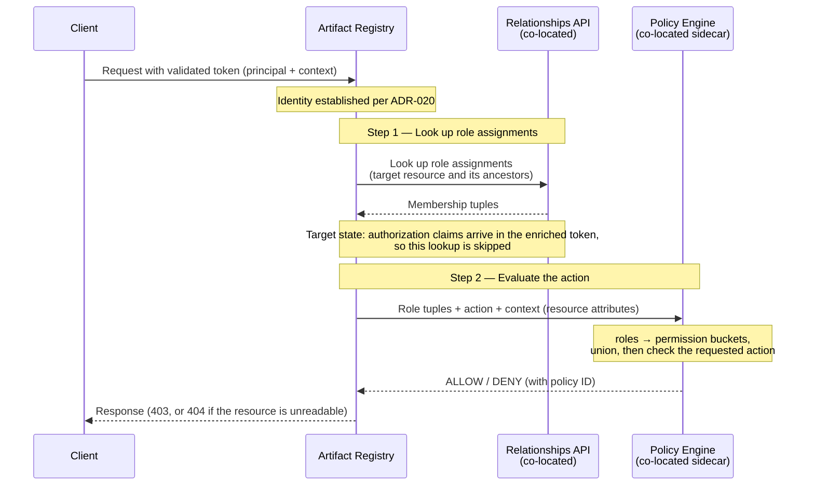

## Status

**Proposed**

This ADR covers **authorization** only — what an authenticated caller may do. **Authentication** (how the caller's identity is established, and how the token is issued and validated) is covered separately by [ADR-020: Authentication Flow](020_authentication_flow.md).

## Context

The Artifact Registry runs on a satellite service separate from the GitLab Rails monolith. [ADR-020](020_authentication_flow.md) establishes the caller's identity from a short-lived token that the Artifact Registry validates locally, without calling back to the GitLab instance during request processing. This ADR decides **what that caller can do**.

The [Artifact Registry and Auth Platform interface agreement](/handbook/engineering/architecture/design-documents/artifact_registry/agreements/auth/) defines six requirements (R1–R6). ADR-020 consumes the authentication requirements (R1–R3). This ADR consumes the authorization requirements: **R4 (policy evaluation engine)**, **R5 (relationships API)**, and **R6 (bootstrapping)**.

### The permission model

To grant or deny an operation, the Artifact Registry evaluates three parts:

- **Principal**: the authenticated user, identified by the token's `sub` claim ([ADR-020](020_authentication_flow.md#token-payload-r3)). Every credential type (personal, OAuth, CI job, group, or project access token) resolves to the same `User` principal, so **closed beta authorizes by principal alone, independent of which credential was used**. A leaked CI job token therefore carries the user's full permissions; closed beta accepts this trade-off because tokens are short-lived by default. Differentiating authorization by credential type is an [open question](#open-questions).
- **Operation**: a repository management operation or an artifact operation ([ADR-009](009_api_design.md)).
- **Resource**: the namespace (the registry as a whole; see [ADR-022](022_namespace_decoupling.md)) or an individual repository. The namespace maps one-to-one to the organization in closed beta.

The Artifact Registry uses a **roles and permissions** model. **Roles** define _who the principal is_ in the context of a resource, through an assignment in the [relationships API](#role-assignment) (R5). **Permissions** define _what the principal can do_: each role maps to a fixed set of permissions, a [permission bucket](#default-permission-buckets). An operation is granted when the required permission is in the principal's effective permission set.

### Constraints

Three constraints shape the decision:

- **Closed-by-default.** Membership in the organization (or its groups and projects) does not grant any Artifact Registry access. A principal has no permissions until an Artifact Registry role is explicitly assigned.
- **No inheritance from platform membership.** Top-level group and project roles do not map to Artifact Registry roles, which are product-specific and assigned independently.
- **No callbacks to the GitLab instance during request processing.** Everything needed to authorize a request must be available without reaching the GitLab instance, which may be unreachable.
  The constraint targets _that instance_, not the dependencies the Artifact Registry is itself deployed and provisioned with — the relationships API, the GLAZ policy-engine sidecar, the key-value store, and the relational database — which share its failure domain (see the [interface agreement](/handbook/engineering/architecture/design-documents/artifact_registry/agreements/auth/#no-callbacks-during-request-processing)).
  If a dependency the decision needs an answer from is unavailable, authorization fails closed; the final fail-open versus fail-closed policy is an [open question](#open-questions).
  A cache is not such a dependency: losing one degrades to resolving the answer directly.

## Decision

**Define product-specific Artifact Registry roles. Assign them to the namespace and to individual repositories through the auth platform's relationships API. Evaluate permissions through the co-located policy evaluation engine (GLAZ, a sidecar) using built-in role-to-permission defaults. Access is closed-by-default; Organization Administrators are bootstrapped with full access.**

The auth platform stores role assignments (relationships) and provides the policy evaluation engine. The Artifact Registry owns the role definitions and the permission model, and drives every decision through the co-located engine.

### Roles

The Artifact Registry defines its own **product-specific roles**, scoped to the Artifact Registry and distinct from platform roles. **Artifact Admin** is the only role that manages access. **Artifact Manager** manages repositories and artifacts, but not access.

These are **user roles**, distinct from the platform **user types** (for example, Organization Administrator or Organization Member). A user type does not imply any Artifact Registry role; the two are assigned independently ([roles management work item](https://gitlab.com/gitlab-org/gitlab/-/work_items/593455)).

Organization Administrators are **bootstrapped** with access equivalent to namespace-level Artifact Admin (R6). The role definitions give their organization-level owner relationship, maintained as ownership changes, access to the organization's namespace and every repository under it. The grant cannot be revoked or downgraded while they remain an owner. It flows through ordinary relationship records, so it needs no special case, and an Organization Administrator can create repositories and assign roles before any other assignment exists.

Custom roles are out of scope for closed beta; see [Custom roles](#custom-roles).

### Permissions

Every operation requires one permission from a fixed set the Artifact Registry defines.

Permissions follow [GitLab permission conventions](https://docs.gitlab.com/ee/development/permissions/conventions.html): every permission names an action and a `resource(_subresource)`, and the action is one of `read`, `create`, `update`, or `delete`. Two consequences of applying that convention here:

- **Reversible relationships are modeled as resources**, not bespoke verbs. A virtual repository's upstream is a `repository_upstream` — created to associate a hosted or remote repository, deleted to disassociate it.
- **Caching reuses the artifact permissions** — there are no separate cache permissions. Remote repositories serve cached artifacts through the same endpoints ([ADR-009](009_api_design.md)), so viewing and evicting them take `read_artifact` and `delete_artifact`.

Tags, such as container image tags and npm dist-tags, follow the artifact permissions by verb. Publishing covers re-publishing where the format's protocol permits it (Maven `SNAPSHOT` redeploys, OCI tag re-pushes); there is no separate overwrite permission, and preventing overwrites is a deferred [access-rule](#access-rules) capability.

### Default permission buckets

Each role maps to a fixed set of permissions. A role holds the same permissions wherever it is assigned; what changes is _reach_ — a namespace assignment applies them across the registry, a repository assignment only to that repository.

Each role is an independent permission bucket: it grants exactly its own permissions, with no hierarchy or inheritance between roles.

Managing role assignments is not an Artifact Registry permission; only Artifact Admin holds it ([Role assignment](#role-assignment)).

### Repository visibility

Each repository has a visibility level stored in the Artifact Registry database, not synced to any external entity. **Closed beta supports `private` only**: no access without an assigned role.

`internal` (readable by organization members) and `public` (readable by anyone, including unauthenticated callers) each grant read without a role, which breaks the closed-by-default constraint: membership determines who _can_ be granted access, not the grant itself. Both are [deferred to GA](#public-and-internal-visibility).

Write and management operations always require the corresponding permission from an assigned role, regardless of visibility.

### Namespace-level and repository-level resources

Each permission is checked against the resource the operation addresses: the namespace or one repository.

- **Namespace**: every management permission binds here and applies across the registry. `create_repository` acts only here and has no repository-level meaning.
- **Repository**: every permission except `create_repository` binds here, for that repository and what it contains — its details, statistics, configuration, deletion, upstream associations, and artifacts.

One permission name can therefore ask a different question per level: `update_repository` gates registry-wide settings on the namespace, and the repository's own configuration on a repository.

### Role assignment

Roles are assigned through the auth platform's [relationships API](/handbook/engineering/architecture/design-documents/artifact_registry/agreements/auth/#r5--relationships-api) (R5) as `(subject, role, resource)` tuples, where the subject is the relationships-API [`Identity`](https://gitlab.com/gitlab-org/auth/iam/-/blob/main/docs/relationships-api.md#subject-and-identity) type (`origin`, `origin_id`, `local_id`) resolved from the token, and the resource is an Artifact Registry namespace or repository. A role assignment binds the subject to a resource within that subject's organization.

Any role can be assigned at either of **two resource levels**:

- **Namespace**: the role applies to every repository in the registry. This is the baseline that lets administrators grant access to thousands of users at scale.
- **Repository (direct, additive)**: the role applies to that repository only. It needs no namespace-level assignment, so a principal can hold access to a single repository and nothing else. With roles at both levels, the effective permissions on the repository are the **union** of the two: a repository-level assignment can only grant more, never less. Restricting access on a specific repository is [deferred](#reductive-repository-overrides).

**Managing role assignments is reserved for Artifact Admin**, with the same capability at either level and only its scope differing. Artifact Manager manages repositories, not access: it grants no roles and writes no access rules. Assignments are managed in the GitLab UI, through the organization's access-management experience, where Rails provides the frontend and API (R5) and the relationships API authorizes each write.

**Each request resolves against one resource.** The relationships lookup is filtered to the resource the request addresses and its ancestors (repository → namespace → organization), so an assignment on a _different_ repository never enters the decision. Because assignments only add, the effective role is the highest applicable one. A request served **through a virtual repository** resolves against the **virtual repository's** assignments, while a request addressed **directly** to a contained hosted or remote repository resolves against that repository's. A role on the virtual repository therefore grants access to the content it aggregates _as served through it_ — by design, not a bypass of a contained repository's assignments.

How role assignments reach the Artifact Registry depends on the iteration:

- **Closed beta**: the token carries no authorization claims. The Artifact Registry reads the principal's assignments from the relationships API and passes the tuples to the policy engine. It caches the lookup for a short, configured duration in the [key-value store it is provisioned](/handbook/engineering/architecture/design-documents/artifact_registry/agreements/infrastructure/#isolation-levels), so one entry with one expiry serves the whole fleet. The cache is keyed on the lookup's inputs — the principal, the target resources, and the relationship kinds — so a result is never reused across a different principal or resource. Losing the store degrades the cache to direct lookups rather than failing the decision.
- **Target state**: the auth platform's enrichment layer resolves role assignments and includes the authorization claims in the enriched token, so no lookup is needed. The shape of those claims, which ADR-020 defers to this ADR, is defined when the enrichment layer ships.

**A role-assignment change, a revocation included, is not observed immediately.** The delay is up to one cache duration plus the relationships API's own write-to-read lag: a cache fill that lands after a write but before that write is readable serves the old answer for a further full duration. The relationships API's lag is not yet measured, so no total window is stated. Entries expire per key, and the key names the target resources, so a denial on one resource does not establish that a revocation has taken hold on another.

### Authorization flow

Authorization begins after authentication: the Artifact Registry has already validated the token and established the principal ([ADR-020](020_authentication_flow.md)). It then reads the principal's role assignments from the relationships API and asks the co-located policy-engine sidecar to evaluate the requested action — without calling back to the GitLab instance.

An unauthenticated request carries no token and is denied: closed beta has no public repositories (see [repository visibility](#repository-visibility)).

When an operation is denied, the status code depends on whether the principal may even see that the resource exists:

- **The principal cannot read the resource** (for example, a private repository on which they hold no role): the Artifact Registry returns **404 Not Found**, so it does not confirm the resource exists.
- **The principal can read the resource but lacks the specific operation** (for example, they hold a role but not `delete_repository`): the Artifact Registry returns **403 Forbidden**, since the resource's existence is already known to them.

In neither case does the response reveal the permission or policy that caused the denial. The policy engine returns the policy ID that determined the decision (R4) for audit logging and debugging.

### List operations

A list spans many resources at once, so it does not fit the single-resource evaluation above.

**Listing repositories (namespace-scoped).** The Artifact Registry decides this from the principal's role assignments rather than one policy check per repository:

- A principal holding **any namespace-level role** can list **all** repositories in the namespace. Every role includes `read_repository`, so this reduces to "does the principal hold a role at the namespace?"; the Artifact Registry then enumerates the repositories from its own database.
- A principal with **no namespace-level role** sees only the repositories where they hold a **repository-level assignment** — closed beta has no visibility level that grants read without a role. The Artifact Registry asks the relationships service which resources the principal holds grants on, intersects them with the namespace's repositories, and evaluates only those, so the cost follows the principal's grants rather than the namespace's size. That lookup takes no namespace scope, so the bound is the principal's grants across the whole IAM instance.

Viewing registry-wide statistics works the same way: they summarize the whole registry rather than a single repository, so they require a namespace-level role.

**Listing within a repository (repository-scoped).** Browsing a repository's contents or sub-resources targets a single repository, so it is an ordinary point check on that repository.

A list of a namespace's repositories omits the resources the principal cannot read rather than rejecting the request — an empty or partial list, with no error and no indication that hidden resources exist, preventing metadata leakage. A sub-resource list whose rows the addressed resource already names keeps them, with deny on every action ([Permission checks for UI gating](#permission-checks-for-ui-gating)). This is also the landing experience: the registry's navigation entry is not gated on any permission check ([ADR-014](014_frontend_to_artifact_registry.md)) — other gates, such as the Artifact Registry being enabled for the organization, still apply — so a principal with no access lands on the repository list and sees it empty.

### Permission checks for UI gating

The frontend must know which actions to render — buttons, tabs, routes — before the user attempts any, and only the Artifact Registry can answer. It exposes **permission checks**: an allow or deny verdict per action for the calling principal. Checks name actions rather than enumerate permissions: the permission-to-action mapping belongs to the Artifact Registry.

Verdicts **embed in the management API's domain responses**, opt-in: the repository detail response carries that repository's verdicts, and the repository list response carries the namespace verdicts and each row's — one call per page. **An embedded element can carry verdicts of its own**, answering for the resource that element represents. The namespace's verdicts embed in a namespace details response created for them ([ADR-009](009_api_design.md#management-apis)). It serves the namespace-scoped affordances on pages with no other domain call, and grows additively as the namespace becomes a user-facing entity.

Each surface's action set follows its resource level and is published in the OpenAPI contract, which the frontend reads instead of inventing actions. A permission verdict follows the [resource levels](#namespace-level-and-repository-level-resources). A role verdict, for the `*_role_assignment` actions, applies the relationships API's rule for role-assignment writes: allowed only for an Artifact Admin on the repository or its namespace, or an Organization Administrator.

Four rules govern the contract:

- **Advisory only.** Verdicts pre-gate UI affordances; the Artifact Registry still authorizes every real request ([authorization flow](#authorization-flow)), so a stale verdict can mis-render a control, never grant access — which is why consumers may cache verdicts. Verdicts cover authorization only: rendering also requires the namespace status the platform caches ([ADR-022](022_namespace_decoupling.md)), and the Artifact Registry enforces both on the real request.
- **The caller is the end user.** The platform obtains a token for the current user and calls the management API as that user ([ADR-020](020_authentication_flow.md)). The Artifact Registry never accepts a service caller asserting a user identity, so verdicts stay off the GitLab API surface, which authenticates services, never end users ([ADR-009](009_api_design.md#gitlab-api)). No permission is needed beyond authentication: existence-hiding plus deny-by-default means a caller with no access learns nothing the gated endpoints would not reveal.
- **Existence-hiding.** A repository the principal cannot read gets the domain response's own **404 Not Found**, indistinguishable from a missing one.
  The namespace endpoint answers any authenticated principal of the owning organization, with deny on every action when nothing is assigned; a caller from another organization, like an unknown slug, gets 404.
  **Embedded verdicts never change a row set**: a resource the principal cannot read stays listed, with deny on every action, wherever the addressed resource's response already names it — for example, the sibling repositories a virtual repository's upstream list resolves through.
  The omission rule under [List operations](#list-operations) still governs every list whose rows are not already named.
  Responses carry allow or deny only, never the deciding policy or reason.
- **Embedded and opt-in.** Verdicts ride the response of the data they gate, only when requested, so the two cannot disagree and a consumer that renders nothing pays nothing.

A sub-resource list gates only on the addressed resource, so its verdicts are evaluation the route would not otherwise do, bounded by the page and by the entity count caps of [ADR-004](004_data_and_application_limits.md#entity-count-limits). A row's verdicts come from that row's own evaluation: a failed row evaluation fails the whole request instead of dropping out silently, as does an unreachable dependency the decision needs. Consistency across a request's lookups is bounded by the role-assignment cache duration, not atomic.

The shape follows [proposal 016](https://gitlab.com/gitlab-org/architecture/auth-architecture/design-doc/-/blob/main/proposals/016-batchcheck-ar-ui-authorization.md): verdicts embedded in the domain responses, resolved through its AR-GLAZ [`BatchCheck` contract](https://gitlab.com/gitlab-org/architecture/auth-architecture/design-doc/-/blob/main/proposals/016-batchcheck-ar-ui-authorization.md#interface).

### Non-production development mode

The decision above governs every deployment that serves real artifacts. For local development and test rigs, the Artifact Registry also supports a **non-production development mode**, whose authorization half leaves authorization unenforced: nothing calls the relationships API or the policy engine, and every check a caller could reach — [point checks](#authorization-flow), [list filtering](#list-operations), and [UI gating verdicts](#permission-checks-for-ui-gating) — answers allow. It is an explicit operator opt-in, off by default: an omitted, empty, or disabled setting yields the enforcing posture.

Three guards bound it:

1. **It is rejected alongside a configured IAM block** when configuration loads, so a deployment provisioned to enforce cannot also opt out.
1. **A boot with neither it nor an IAM block fails**, so serving without authorization is always something an operator asked for.
1. **A boot under it logs the posture once at WARN.** The enforcing posture is logged too, so an unenforced boot leaves a record of its own.

**Unenforced is not anonymous access.** The mode makes no authorization decision, so it cannot widen one to admit callers without a role; a request presenting no credential is still rejected by authentication. It therefore does not reopen the [deferred](#public-and-internal-visibility) `public` and `internal` levels, which grant read to a caller holding no role while authorization is still evaluated.

One switch selects this half together with ADR-020's [non-production development mode](020_authentication_flow.md#non-production-development-mode) for authentication. That mode's credential establishes no principal, which enforced authorization would deny on every request while the deployment looks healthy; one switch makes that state inexpressible.

### Services in the same cluster

A caller authenticated by its Kubernetes service account ([ADR-020](020_authentication_flow.md#services-in-the-same-cluster-kubernetes-service-account-tokens)) has no role assignments. On a route that admits it, the policy engine evaluates it as an **Artifact Manager on the addressed resource**, with no relationships lookup. It names no organization, so the grant holds in every organization those routes reach. This first step stays off by default behind a switch; organization scoping is [open](020_authentication_flow.md#future-work--open-debates). Every other route denies it with **403 Forbidden**. This is not the unenforced posture above: authorization still runs under the enforcing posture.

## Deferred to later iterations

The following capabilities are intentionally out of scope for closed beta. They are documented here so the design is on record, and will be revisited based on closed-beta customer demand.

### Public and internal visibility

Closed beta supports only `private` visibility (see [Repository visibility](#repository-visibility)). Reintroducing `public` (read for anyone, including unauthenticated callers) and `internal` (read for organization members) requires deciding how to grant broad read access while remaining closed-by-default, so both are deferred to GA.

### Reductive repository overrides

Closed beta repository-level assignments are **additive (raise-only)** (see [Role assignment](#role-assignment)).

Lowering a principal's access on a specific repository (a reductive override) is out of scope, because it conflicts with role inheritance as it works across GitLab — a namespace-level assignment carries down to every repository. When this is added, the Artifact Registry will resolve precedence by reading the principal's permissions at both the namespace and repository levels and letting the repository level win outright — raising _or_ lowering access — instead of taking their union.

### Access rules

Access rules let an Artifact Admin tighten _which roles hold an artifact permission_ — on the namespace, a repository, or artifacts matching a pattern — without naming a principal. They cover two customer use cases: protecting specific artifacts, and allowing or preventing duplicate uploads. Modeled as user-defined policies for the policy engine (R4), they can only tighten — never widen — the built-in defaults, and would be managed through a dedicated set of `*_access_rule` permissions introduced with the feature. Because they are deferred, closed beta cannot tighten any permission per repository.

### Custom roles

Custom roles are deferred from closed beta. See the [custom roles roadmap work item](https://gitlab.com/gitlab-org/gitlab/-/work_items/590721).

Because roles are independent permission buckets, a custom role is a new bucket with any combination of Artifact Registry permissions (for example, a "CI Publisher" role with `read_artifact` and `create_artifact` but not `read_repository`). It is assigned through the same relationships API and can be referenced in access rules like a built-in role.

## Consequences

### Positive

1. **Aligned with the platform direction.** The Artifact Registry consumes the auth platform's relationships API and policy evaluation engine (R4, R5) rather than building a bespoke authorization system, matching the consolidation direction.
1. **Self-contained evaluation.** Once role assignments are available (resolved in closed beta, or carried in the enriched token in the target state), permission decisions are made through the dependencies the Artifact Registry is itself deployed and provisioned with, without calling back to the GitLab instance.
1. **Permission model preserved and portable.** Roles as independent permission buckets match the policy engine's "deny overrides" model, minimizing future migration effort.

### Negative

1. **Closed-beta role resolution.** Until the enrichment layer ships, the Artifact Registry resolves role assignments itself by querying the relationships API, which is more involved than reading a claim from the token.
1. **Onboarding overhead.** Closed-by-default requires explicit role assignment, which adds management effort. This is mitigated by bulk assignment workflows in the Organizations UI.
1. **Potential role proliferation.** Product-specific roles can grow into a large list over time. This is mitigated by Teams and group templates as the scaling mechanism, per the [roles management work item](https://gitlab.com/gitlab-org/gitlab/-/work_items/593455) north star.
1. **No per-repository tightening in closed beta.** Without access rules or reductive overrides, a principal's access can only be raised on a repository, never lowered — a namespace-level assignment reaches every repository with no way to carve out exceptions. Both are [deferred](#deferred-to-later-iterations) and revisited on customer demand.

## Alternatives considered

### Organization Teams

[Organization Teams](https://gitlab.com/gitlab-com/content-sites/handbook/-/merge_requests/17975) assign users a base role plus optional permission modifiers. The Artifact Registry could use a Team per organization for baseline access, and sub-teams for per-repository granularity.

**Why not adopted now**: Organization Teams are in `proposed` status and not available in the Artifact Registry timeline. Teams remain the likely future scaling mechanism for role assignment (per the [roles management work item](https://gitlab.com/gitlab-org/gitlab/-/work_items/593455) north star), and role assignments made through the relationships API are compatible with that direction.

### Artifact Registry-native authorization

The Artifact Registry could maintain its own user-resource relationships and permission logic without relying on the auth platform.

**Why not adopted**: it would introduce another authorization system alongside the platform's, adding fragmentation — the opposite of the consolidation direction. It would require building user management from scratch, produce an inconsistent user experience, and be harder to converge with the platform later. The relationships API (R5) provides the per-resource role assignment that this ADR needs without those downsides.

## Open questions

1. **Behavior when the relationships service is unavailable.** Closed beta fails closed (the request is denied), but the fail-open versus fail-closed policy is still being finalized.
1. **Organization-to-namespace resolution at scale.** Role assignments attach to the Artifact Registry namespace, which maps one-to-one to the organization in closed beta ([ADR-022](022_namespace_decoupling.md)). If a future organization merge places multiple namespaces under one organization, define how organization-wide concerns — owner bootstrapping and the org-scoping invariant on assignments — resolve across them.
1. **Credential-type-aware authorization.** Closed beta authorizes by the `User` principal alone; all credential types resolve to the same principal (ADR-020), so a leaked CI job token carries the user's full permissions. Whether to constrain authorization by credential type — for example, limiting CI job tokens to publish-only — is deferred. It would require ADR-020 to carry the credential type in the token first, so it is a joint ADR-020/ADR-021 follow-up.
1. **Interface agreement alignment.** The [interface agreement](/handbook/engineering/architecture/design-documents/artifact_registry/agreements/auth/#gitlab-role-vocabulary) still states that the Artifact Registry uses the five built-in GitLab roles and "does not define its own roles", and its [no-callbacks constraint](/handbook/engineering/architecture/design-documents/artifact_registry/agreements/auth/#no-callbacks-during-request-processing) exempts co-located platform services by example rather than by its reachability rationale. Both need a companion update, coordinated with the Auth Platform team.
1. **Caching the repository-list authorization scan.** The repository list shows edit and delete controls on each row, so the list endpoint must both hide the rows a caller cannot read and return verdicts per row. Where the caller holds a grant on the namespace or its organization, that is an evaluation of every repository in the namespace (bounded by the repositories-per-namespace cap of [ADR-004](004_data_and_application_limits.md#entity-count-limits)), reachable by any such caller and repeated on every page load. How to cache and rate-bound that scan is unresolved ([proposal 016's open question](https://gitlab.com/gitlab-org/architecture/auth-architecture/design-doc/-/blob/main/proposals/016-batchcheck-ar-ui-authorization.md#open-questions)).

## References

- [ADR-001: Organizations as Anchor Point](001_organizations_as_anchor_point.md)
- [ADR-009: API Design](009_api_design.md) — management API and client API endpoints
- [ADR-020: Authentication Flow](020_authentication_flow.md) — identity establishment and token validation
- [ADR-022: Namespace Decoupling](022_namespace_decoupling.md)
- [Artifact Registry and Auth Platform interface agreement](/handbook/engineering/architecture/design-documents/artifact_registry/agreements/auth/) — the R4–R6 (authorization) requirements consumed here
- [Relationships API](https://gitlab.com/gitlab-org/auth/iam/-/blob/main/docs/relationships-api.md) — the IAM relationships API contract; in closed beta it returns direct relationship tuples for a resource and its ancestors, which the policy engine evaluates as a union (additive repository-level assignments)
- [GitLab permission conventions](https://docs.gitlab.com/ee/development/permissions/conventions.html) — the naming and CRUD-decomposition rules these permissions follow
- [Roles management and Artifact Registry onboarding](https://gitlab.com/gitlab-org/gitlab/-/work_items/593455) — product-specific roles, closed-by-default, three-part model
- [Proposal 016: BatchCheck](https://gitlab.com/gitlab-org/architecture/auth-architecture/design-doc/-/blob/main/proposals/016-batchcheck-ar-ui-authorization.md) — the AR-GLAZ batch evaluation contract behind the permission checks, and its UI flows
- [UI gating direction (gitlab#602144)](https://gitlab.com/gitlab-org/gitlab/-/work_items/602144#note_3532439195) — the agreement that UI gating uses action-based checks answered by the registry
- [GATE Design Document](https://gitlab.com/gitlab-org/architecture/auth-architecture/design-doc/-/blob/main/design.md) — GitLab Adaptive Trust Environment
