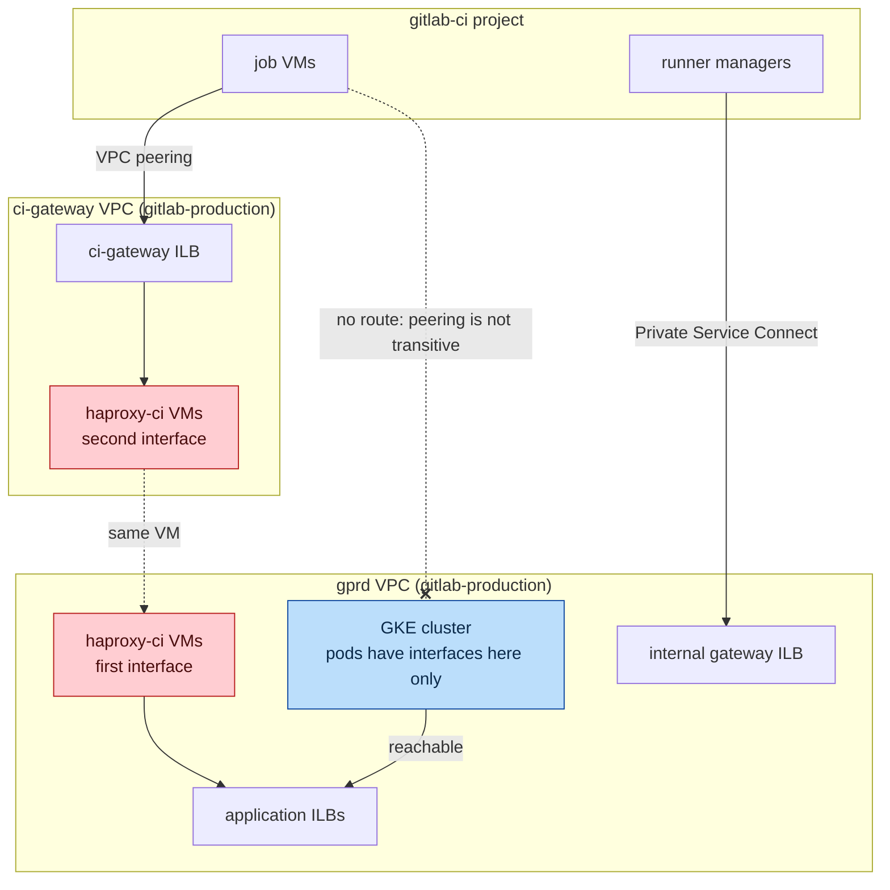
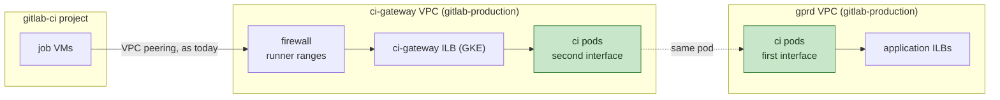

## Status

Accepted, in progress.

Running in `gstg`, where the pods serve the job VMs' ci-gateway
traffic.

## Stakeholders

- Networking and Incident Management
- Runners Platform: the ci-gateway clients and the runner egress firewall
- Fleet Management: multi-networking on the Dataplane V2 cluster and the node pools with a second network

## Context

Job VMs in the `gitlab-ci` project fetch git repositories and upload
artifacts through `us-east1.ci-gateway.int.gprd.gitlab.net`. That
hostname resolves to an ILB in a dedicated `ci-gateway` VPC in
`gitlab-production`, which the job VM networks are peered with. The
`haproxy-ci` VMs have one interface there and one in the `gprd` VPC,
and route between the two. The runner managers do not use ci-gateway
any more. They talk to the API and kas through Private Service Connect
endpoints ([ADR 001](001_traffic_cutover.md)).

The cutover is a DNS change: the hostname gets the pod load balancer's
address ([ADR 001](001_traffic_cutover.md)). For that to work, the pod
load balancer has to be in a network the job VMs can route to. That is
what this record decides.

## Decision

The `ci` pods get a second interface in the `ci-gateway` VPC, same as
the VMs. This is accomplished through
[GKE multi-networking](https://docs.cloud.google.com/kubernetes-engine/docs/how-to/setup-multinetwork-support-for-pods):
the `haproxy-ci` node pools have an interface in `ci-gateway`, each pod
gets an address from a pod range on that subnet, and a Service on that
network gives us an internal load balancer there. The existing hostname
points at that load balancer.

- The runner networks, their peerings, and the isolation between them
  and `gprd` are as today. The pods see the runner address, and the
  frontend's `src` ACLs are unchanged.
- The runner egress firewall allows the GKE subnet in `ci-gateway`,
  next to the VM subnet.
- Multi-network Services need Dataplane V2, which the legacy clusters
  (`gprd-gitlab-gke`) do not have and cannot be switched to. The `ci`
  release is built on the new cluster of each environment
  ([ADR 003](003_release_topology.md)).

## Consequences

- The chart renders the second interface: pod annotations for the two
  interfaces, an init container that adds a routing table so traffic
  from the second pod range leaves through the second interface, and a
  Service that selects the network. The Service is one internal
  `LoadBalancer` with `externalTrafficPolicy: Local`, which GKE
  requires on a secondary network.
- The `Network` objects are their own argocd/apps service, one per
  cluster, and are immutable. A pool's networks are fixed at creation.
- The pods have two interfaces and a routing table to reason about in
  an incident, and a second pod range, on the `ci-gateway` subnet, that
  backend allowlists have to include next to the cluster pod range
  ([ADR 001](001_traffic_cutover.md)).
- The cutover is a DNS record change, no runner config changes. The
  legacy zonal ILBs and hostnames are not recreated. The dual-interface
  VMs and the multi-NIC routing recipe are removed with the VM fleet.
- The `ci` release serves the job VMs: git fetches, the job API calls
  for traces and artifacts, and redirects, as the VM frontend does.

## Alternatives considered

### Peer the runner networks with gprd

Peer the ephemeral job VM networks with `gprd` directly, as the `ci`
VPC with the runner managers already is, and put the ci-gateway ILB in
front of the pods in `gprd`. No second interface, no new GKE feature,
and the `ci-gateway` VPC is removed. Rejected because a job VM network
can reach one address in `gitlab-production` today, and peered with
`gprd` it could route to any internal address there, with a firewall
rule as the only boundary. Job VMs run customer code. Whether that is
acceptable is a Runners Platform decision, and this migration does not
depend on it.

### Peer ci-gateway with gprd

Rejected because it does not work: runner VPC to `ci-gateway` is one
peering and `ci-gateway` to `gprd` is another, and peering is not
transitive.

### A GKE cluster with nodes in the ci-gateway VPC

A node pool cannot span VPCs. This is a separate cluster in
`ci-gateway`, plus a peering from `ci-gateway` to `gprd` so the pods
can reach the application backends. Today's isolation exactly. Rejected
because the cluster needs its own Consul access for the agent,
monitoring, ArgoCD registration, and node pools, for one release, and
it goes against the cluster consolidation.

### Private Service Connect

PSC as the way into the `ci-gateway` VPC instead of a second interface:
the `ci` release's ILB published as a service attachment, and an
internal TCP proxy load balancer in the `ci-gateway` VPC with a PSC NEG
as its backend, sending PROXY protocol so the pods see the job VM's
address. It works and needs nothing from the runner side. Rejected
because PSC and the proxy each charge per GB, and `ci` serves job
artifacts and git fetches. The runner managers' PSC endpoints for the
API and kas are a different path with far less traffic, and stay.

### Leave haproxy-ci on VMs

Nine VMs with one purpose and a narrow interface, which could remain on
Chef until the Envoy Gateway migration reaches them. Rejected because
the VM fleet would keep its Chef roles, patching, and the multi-NIC
routing recipe for one release.

## References

- [GKE multi-network support for Pods](https://docs.cloud.google.com/kubernetes-engine/docs/how-to/setup-multinetwork-support-for-pods)
