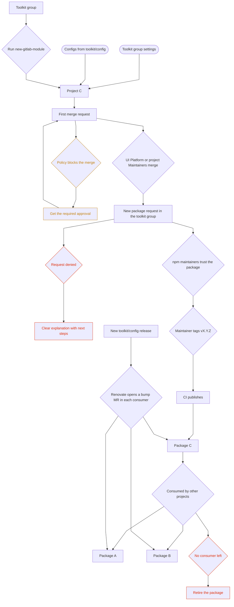

## Context

As we start working on modularity, the polyrepo approach to smaller repositories can give us great speed, but it is essential that there are tools and guardrails in place to make sure that all of our packages stay aligned and require minimal maintenance in the longer run.

Based on the decision in [ADR-001](./001_tooling_repository_strategy.md#decision), it is already agreed that standalone utils packages are polyrepos, where each one gets to be more or less independent from others, while tooling packages that have tight dependencies would live in a single package, such as eslint, TSconfig, CI config helpers, etc.

This ADR aims to clarify these packages, where they live, how they are created, how they remain discoverable and how they are maintained.

ADR-001 called the tightly coupled tooling a pnpm workspace. Since those configs always change together, we make them one package instead, `@gitlab/frontend-config`, with a subpath per config (`@gitlab/frontend-config/eslint`, `@gitlab/frontend-config/tsconfig`) and the CI templates under `ci/`. One version then serves both the npm dependency and the CI `include`, see [How do we keep packages in sync?](#how-do-we-keep-packages-in-sync). We looked at separate `@gitlab/eslint-config`, `@gitlab/tsconfig` and `@gitlab/ci-templates` packages, but three bumps per consumer is not worth it. If we ever need independent versions, the subpaths can become workspace packages later.

## Package lifecycle

The flow below is the whole ADR in one picture, from creating a package to consuming it. Each step is detailed in its own section.



## Where do packages live?

We want a central group that holds all of the packages that we consider are reusable. The first two packages that were created ended up in `gitlab-org/frontend/` which is a good landing place, but it lacks the single purpose. A lot of projects in this group are not related to our new UI platform effort, and so it becomes noisy as we cannot have a single spot to see all packages.

### Decisions

1. Create a new group called `gitlab-org/frontend/toolkit` (we avoided `packages` as a name because, like `utils`, it invites everything in).
1. Migrate both `@gitlab/frontend-utils` and `@gitlab/frontend-tests` to this new group.
1. Create a new project `gitlab-org/frontend/toolkit/config` that publishes `@gitlab/frontend-config` and holds the shared setup. Projects in the group are named after what they publish (`tests`, `utils`), so `config`, even though it also ships the CI template and the bootstrap script.
1. Add a clear description to the group that new projects added here are intended to become reusable packages.
1. Ensure that these packages still ship to our npm registry.

### Migrating the existing packages

We transfer `@gitlab/frontend-utils` and `@gitlab/frontend-tests` as projects, so history, issues and MRs come along. For each package:

1. Transfer the project to `gitlab-org/frontend/toolkit` from its general settings. GitLab redirects the old path as long as nothing else claims it.
1. Update the trusted publisher on npmjs to the new project path, otherwise the next release fails.
1. Check that the group settings from [What rules does this group need?](#what-rules-does-this-group-need) are inherited and that no leftover project-level settings conflict with them.
1. Replace any CI `include` or link that uses the old path, then cut a release to confirm publishing works.

The npm package names do not change, so consumers are not affected.

## What rules does this group need?

There are common settings that all packages should inherit. New package authors should not have to check them, and they should not be able to turn them off when convenient: no self-approval, required reviews, no push to `main`. Nobody should have to read documentation to find the right configuration for their package. Nobody should be able to create 100k lines of code, merge them unreviewed, then enable our standards after the fact in the name of speed or iteration.

### Decisions

GitLab can push settings from the group down to every project, including future ones. We use four layers.

1. Group settings that projects cannot override.
   - A group-level protected branch on `main`: nobody can push, Maintainers can merge, code owner approval required.
   - Group push rules: reject unsigned commits and require the commit author to be a GitLab user.
   - Default branch protection set to fully protected so new projects start right.
   - Merge request approval settings only exist on top-level groups, so the policy below handles those.
1. A security policy project, `toolkit/security-policies`, with one merge request approval policy for every MR in every project: one Maintainer approval, no approving your own MR or commits, approvals reset on new commits, no pushing to or editing protected branches. Projects cannot turn it off. Which Maintainers count is up to each package's CODEOWNERS, see [How do we define maintainers?](#how-do-we-define-maintainers).
1. A compliance framework `frontend-compliance` applied by default to every project in the group. The Compliance Center then shows each project and whether it still follows the rules above.
1. The bootstrap script for the rest. Protected tags `v*` are project-level, so `new-gitlab-module` sets them when it creates the project. A scheduled job in the tooling project compares every project against this baseline and opens an issue when something drifted.

We cannot stop someone from importing an existing repository with its history. What we can do is make `main` protected the moment it lands, require the policy approval on every change after that, and only publish once the request in [How do we publish packages?](#how-do-we-publish-packages) is approved, which is when someone actually looks at what came in.

### Considered and rejected

A pipeline execution policy that injects `ci/base.yml` into every pipeline in the group. It would guarantee the base jobs run even if a project removes the include, but it pins one `ref` for the whole group, and we want each package to bump when it makes sense to them. CODEOWNERS on `.gitlab-ci.yml` already makes removing the include a reviewed change.

## How do we create new packages?

It should be possible to bootstrap a new package quickly without relying solely on AI to scaffold. Ideally, we would want the developer experience to look something like this:

1. Developer needs to create a new reusable package.
1. They run `npx new-gitlab-module`.
1. This script asks a few questions through a TUI such as package name, purpose, stack, etc.
1. The script is dynamically loading its configuration from the `@gitlab/frontend-config` package with latest Eslint, TSConfig, CI, etc
1. The repository is created with `.gitlab-ci.yml`, `eslint.config.js` and `tsconfig.json` already wired to `include` and `extends` the `@gitlab/frontend-config` base, see [How do we keep packages in sync?](#how-do-we-keep-packages-in-sync)

This way, creating a new package is trivial and controlled through the TUI setup. As we add package defaults, these options appear in the TUI.

It is a Node script in `@gitlab/frontend-config`, run with `npx`, so there is nothing else to install. On top of rendering the files it creates the project in the group and sets the protected `v*` tags, see [What rules does this group need?](#what-rules-does-this-group-need).

LabBench modules use `copier`, a Python templating tool, for scaffolding. We are not reusing it for the frontend part: it would bring Python into every package and pipeline, and its update feature is the copy-and-diff approach we reject in [How do we keep packages in sync?](#how-do-we-keep-packages-in-sync). The LabBench template calls `new-gitlab-module` for the UI instead, so one script owns the frontend setup everywhere.

## How do we keep packages in sync?

Once a package is created, it has essentially broken free from the constraints of our code standards and best practices. Ideally, each of these consumers is wired to consume `@gitlab/frontend-config` so that the shared setup is never copied into the package, only referenced:

1. CI is remote. The package `.gitlab-ci.yml` is a small stub that `include`s the base file from the tooling project at a pinned `ref` and adds its own jobs below it. Changing the base in the tooling repository and cutting a new tag is enough for every consumer to pick it up on their next bump.
1. Config files are extended. `eslint.config.js` imports the base config from `@gitlab/frontend-config/eslint` and spreads it, `tsconfig.json` uses `extends`. Packages override a few rules on top, in their own file, so overrides never collide with the base.

In practice a package carries three small files and nothing else from the shared setup:

```yaml
# .gitlab-ci.yml
include:
  - project: gitlab-org/frontend/toolkit/config
    ref: v1.4.0
    file: ci/base.yml

package-specific-job:
  script: pnpm run some-extra-check
```

```js
// eslint.config.js
import base from '@gitlab/frontend-config/eslint';

export default [
  ...base,
  {
    files: ['src/**/*.vue'],
    rules: { 'vue/multi-word-component-names': 'off' },
  },
];
```

```json
// tsconfig.json
{
  "extends": "@gitlab/frontend-config/tsconfig",
  "include": ["src"]
}
```

Since both the npm dependency and the CI `ref` point to the same release, an update is a version bump. Package maintainers do it when it makes sense to them, through an MR, and Renovate can open that MR for them: its `npm` manager bumps the dependency and its `gitlabci-include` manager bumps the `ref`, grouped together.

### Considered and rejected

We considered a Shadcn style of update, where the package owns some original version of the config files, we allow the package to iterate on it, and an `update-gitlab-module` script pulls the new source and diffs it against the local copy. This is too complex for our needs: it requires tracking what the package changed, merging it with upstream changes, and resolving conflicts in files that `extends` and `include` already keep separate. We drop the update script. The only files that would still be copied are `.gitignore` and `.tool-versions`, which rarely change and are small enough to update by hand.

## What does the frontend-config package include?

1. Eslint config
1. TsConfig
1. Base `gitlab-ci.yml` template
1. Base `package.json` scripts and dependencies, see [Base scripts](#base-scripts)
1. Test setup wired to `@gitlab/frontend-tests` from [ADR-002](./002_reusable_testing_approach.md), with Rstest as the default framework
1. The reusable script for setup `new-gitlab-module` (name TBD)
1. `.gitignore` for a typical JS/Vue repository.
1. `.tool-versions` for `mise` or equivalent if we ever change tooling manager.
1. (less certain) A .claude directory with frontend-wide directives. This would mean moving the distillation for the frontend docs into this package, and then the monolith would inherit our frontend-wide directives, while retaining the ability to overwrite them as needed.

### Default test framework

ADR-001 named Vitest as an example. ADR-002 settled on Rstest for `@gitlab/frontend-tests` because it aligns with Rspack and tests Module Federation remotes. The toolkit makes Rstest the default: `new-gitlab-module` adds `@gitlab/frontend-tests/unit` and a `test` script that runs it. A package can opt out in the TUI and bring its own framework, at the cost of maintaining that setup itself and losing the shared mount helpers. Deviating should have a reason written in the package README.

### Base scripts

The base CI template calls scripts by name, so every package needs the same entry points. The toolkit ships a `package.json` fragment that `new-gitlab-module` merges into the new package:

```json
{
  "scripts": {
    "build": "rslib build",
    "test": "rstest",
    "fixtures:download": "frontend-tests fixtures download",
    "test:integration": "rstest -c rstest.integration.config.ts",
    "lint": "eslint .",
    "typecheck": "vue-tsc --noEmit"
  },
  "devDependencies": {
    "@gitlab/frontend-config": "^1.4.0",
    "@gitlab/frontend-tests": "^2.0.0"
  }
}
```

`test:integration` runs the integration layer from [ADR-002](./002_reusable_testing_approach.md#how-a-package-consumes-it) with a config that extends `@gitlab/frontend-tests/integration`, which starts the MSW server and serves the Rails fixtures under `tmp/fixtures/`. `fixtures:download` fills that directory and is separate so that developers run it once locally, while `ci/base.yml` runs it before every integration job to test against the latest fixtures. A package gets unit and integration jobs without writing CI.

The build tool and its config are part of this: `ci/base.yml` runs `pnpm run build`, so the toolkit exposes `@gitlab/frontend-config/rslib` as the base build config in the same `extends` style as ESLint and TSConfig. Mixing reference files such as `.gitignore` and `.tool-versions` with the extendable configs is accepted for now. If packages opt out of the copied files often, they move behind a TUI question or out of the toolkit.

## How do we publish packages?

As of now, whenever a new package is created, we need to create a version and ask for someone to configure GitLab's npm trusted publish list with the namespace of the project and the CI file. There is currently little to no one with access, and as such a more formal process should be in place to allow a more systemic review of a new package and a list of owners who can decide the package is warranted, approve and let us publish from the registry.

The registry is the real gate. Nothing reaches npmjs without someone with access on the `@gitlab` scope, and only the approvers have that. So anyone can create a project in the group and iterate on it, we just do not publish it until the request is approved. No CI guard needed, and no need to restrict project creation.

### New package request

Open a work item in `gitlab-org/frontend/toolkit` from the `New package request` template. It must include:

1. The list of developers and maintainers who will work on the package.
1. The consumers of this package and an explanation of why and how it will be reused.
1. A forward looking plan for the next 6 months, how the package is expected to grow.
1. For packages over a certain size (threshold TBD), proof that the code has been reviewed before we publish. A large package merged without review does not get published because it is now convenient to do so.

Rejections should be rare and always come with a clear why from the UI Platform maintainers, written in the issue. The most common reason we expect is "this is not a package, it is a monolith util": code with a single consumer and no reuse plan belongs in the monolith. The other expected reason is that an existing package already covers the need, in which case the proposal becomes a contribution to that package instead.

### Decisions

1. Add a `New package request` issue template to `gitlab-org/frontend/toolkit` that captures the purpose, the owner, and an overlap check with existing packages, and a `Deprecate package` template for [How do we retire packages?](#how-do-we-retire-packages).
1. The approvers are the UI Platform maintainers plus a few Frontend Foundations team members, who are also the people with maintainer rights on the `@gitlab` npm scope.
1. Once approved, an approver does the first publish, from their own npm account or with a short-lived token in a masked CI variable that they delete afterwards. They then set the project up as a trusted publisher so that every following release ships from CI.

### How are versions cut?

We release from tags, the same way `@gitlab/frontend-tests` does today, and `ci/base.yml` ships the job:

1. A package Maintainer creates tag `vX.Y.Z` on `main`, from the Releases page or with `git tag`, and writes the release notes in the release description or the tag message. Nothing is committed, `package.json` keeps a placeholder version such as `0.0.0-dev`.
1. The tag pipeline runs the `publish` job, which sets the version from the tag in the job workspace, publishes to npmjs with provenance through trusted publishing, and creates the GitLab Release with the notes.
1. Protected tags `v*` are open to project Maintainers and the UI Platform team.

```yaml
publish:
  stage: publish
  id_tokens:
    NPM_ID_TOKEN:
      aud: npm
  rules:
    - if: $CI_COMMIT_TAG =~ /^v\d+\.\d+\.\d+/
  script:
    - pnpm version "${CI_COMMIT_TAG#v}" --no-git-tag-version   # workspace only, nothing is committed
    - pnpm publish --provenance --access public --no-git-checks
    - release-cli create --tag-name "$CI_COMMIT_TAG" --description "$CI_COMMIT_TAG_MESSAGE"
```

So a Maintainer tags `v1.3.0`, npmjs shows `1.3.0` with a provenance badge pointing at the pipeline, and the GitLab Release carries the notes. How often a package releases is up to the package.

### Considered and rejected

1. Changesets, which ADR-001 mentions. Every MR adds a changeset file, and a release job turns them into a version bump, a `CHANGELOG.md` and a release MR that a Maintainer merges when they want to ship. It reviews the bump size with the code, but it needs a release bot, a release MR per release and a changeset file per MR, and the tag flow gets us the same timing control with less machinery.
1. Conventional commits with semantic-release, where the version is derived from commit prefixes. Squash merges and the monolith's commit style make the prefixes unreliable, and the bump is invisible during review.
1. A single granular token scoped to `@gitlab/*` stored as a group-level CI variable. It removes the per-package admin step, but every project in the group could publish with it, which bypasses the review above. It is also a long-lived secret with no provenance.
1. Publishing to the GitLab package registry of the group instead of npmjs. Publishing would only need `CI_JOB_TOKEN`, but an npm scope maps to a single registry in `.npmrc` and `@gitlab/*` already lives on npmjs for the monolith, so it would require a new scope or a proxy.

## How do we retire packages?

Packages that nobody consumes still cost reviews, dependency bumps and security fixes. Two scenarios need a process.

### Unused package

A package is unused when a reverse dependency search across the monolith and the other packages in the group finds no consumer. npm download counts are only a secondary signal, since CI mirrors inflate them. The drift job from [What rules does this group need?](#what-rules-does-this-group-need) reports both.

1. As soon as a package is flagged unused, remove its trusted publisher on npm so nothing ships unnoticed, and open an issue from the `Deprecate package` template, noting that publishing again means going through the request process again. Existing versions stay installable.
1. After 6 months without activity and still unused, post in `#frontend` and on the issue, pinging every maintainer, with two weeks to claim the package before we move it out of `toolkit`.
1. If nobody answers, the project moves to `gitlab-org/frontend/archive` and is archived, read-only with its history and a URL redirect. If the code is small and still useful, it is folded into `@gitlab/frontend-utils` instead, and if the monolith was its only consumer, it moves back into the monolith.
1. In all three cases the package is deprecated on npm with `npm deprecate` and a reason, so stale installs warn.

We considered archiving in place inside `toolkit`. It is simpler, but the group exists to be the single spot to see live packages, and archived projects would still show up in it. Deleting the project loses history while the npm versions remain anyway.

### Used but unmaintained package

Since the UI Platform team is on every project, see [How do we define maintainers?](#how-do-we-define-maintainers), a package never has zero maintainers. When its listed maintainers leave or stop responding, we look for new owners by posting in `#frontend` and pinging the teams that consume the package. If no team takes it, the UI Platform team keeps it in maintenance mode, security fixes and dependency bumps only, until a consumer steps up or the package becomes unused.

## How do we define maintainers?

Each of these packages is going to require a list of active maintainers. We could either re-use the existing @frontend-maintainers group from the monolith and give merge rights to everyone, CODEOWNERS rules that would make certain reviewer review mandatory, or creating a smaller pool of maintainers for the tooling packages. Rules might also differ per project.

### Option 1: Frontend maintainers for all packages

Make the monolith frontend maintainers group also the maintainers of `gitlab-org/frontend/toolkit` and let each package define a CODEOWNERS rule if they think they need more controls.

#### Pros

1. The pool of maintainers is large, easy to get reviewers and to merge.
1. We can enforce no-self merge rules and other safety from the get go and not block the author.
1. Knowledge spread stays wide for the whole company.

#### Cons

1. Less control over who gets to contribute. Since packages are wide-impacting, the risk of allowing anyone to merge is much higher.
1. With the push to have "everyone" a maintainer in the monolith, domain expertise is not guaranteed.
1. AI can work faster than we can filter. Anyone allowed to merge and release packages can derail the scope of a package quickly.

### Option 2: UI Platform maintainers + each package additional domain experts

Tooling packages could all be owned by the UI platform team, and each individual package could get more maintainers when they are actively contributing to the package.

### Option 3: Each package define its own maintainers

No assumption is made and each package gets to define who has merge rights.

Note: CODEOWNERS is always an option to weave in any of the options. We could have every Frontend maintainer of the monolith also own the package, but enforce CODEOWNERS of the UI platform team.

### Decision

Option 2, set up so that no package can go below the group's rules:

1. The UI Platform team is the `gitlab-org/maintainers/frontend-toolkit` group, same convention as the other maintainer groups. It is Owner on `gitlab-org/frontend/toolkit` because group settings need that. The team owns the group settings, approves new packages and is the default maintainer of a package until it has its own. Inherited membership cannot be removed at project level, so a package cannot lock the team out.
1. Monolith frontend maintainers inherit Maintainer from `gitlab-org/frontend` and we cannot lower that in a subgroup. So they can merge, and what keeps the bar up is the approval policy and CODEOWNERS, not the role.
1. Each package adds its domain experts as project Maintainers. A project can add members, not remove inherited ones.
1. `new-gitlab-module` writes a CODEOWNERS with `* @gitlab-org/maintainers/frontend-toolkit` as the default, plus one line per shared file for the same group: `.gitlab/CODEOWNERS`, `.gitlab-ci.yml`, `package.json`, `tsconfig.json` and `eslint.config.js`. When a package has its own maintainers, it changes the default line and leaves the shared ones. Code owner approval is on for `main`, so these entries are enforced.
1. Protected tags `v*` are open to project Maintainers and the UI Platform team, see [How are versions cut?](#how-are-versions-cut).
1. No self-approval and no editing of approval rules come from the policy in [What rules does this group need?](#what-rules-does-this-group-need), since group approval settings do not reach a subgroup.

Option 1 is rejected because AI can work faster than we can filter, and the push to make everyone a maintainer in the monolith means the pool is not vetted for package work. Option 3 is rejected because without a baseline an author can approve their own work.

Consequence: the UI Platform team is the reviewer of last resort for every package in the group. This is fine while the group is small and should be revisited once it is not.

## Decision

1. Reusable packages live in `gitlab-org/frontend/toolkit`. `@gitlab/frontend-utils` and `@gitlab/frontend-tests` move there.
1. `@gitlab/frontend-config` is a single package with subpath exports that holds the ESLint config, TSConfig, CI templates and the bootstrap script.
1. Packages reference the shared setup through `include` and `extends` at a pinned version. Renovate opens the bump MRs.
1. Group settings, a merge request approval policy and a compliance framework enforce reviews, protected `main`, and no self-approval on every project, including future ones.
1. Publishing is gated by a request issue reviewed by the UI Platform maintainers plus a few Frontend Foundations team members, who also hold the `@gitlab` npm scope. After the first publish, a release is a `v*` tag by a package Maintainer and CI does the rest.
1. The UI Platform team is `gitlab-org/maintainers/frontend-toolkit`, Owner on the group. It owns the settings, approves new packages and is the default maintainer of a package until it has its own. Monolith frontend maintainers inherit Maintainer from `gitlab-org/frontend`. CODEOWNERS protects the shared files.
1. Unused packages lose trusted publishing right away and move to `gitlab-org/frontend/archive` after 6 months of inactivity and an unanswered call in `#frontend`. Used but unmaintained packages fall back to the UI Platform team until new owners are found.

## Consequences

1. The UI Platform team is the reviewer of last resort for every package and the approver of every new one. This works while the group is small and should be revisited once it is not.
1. Every package needs a CODEOWNERS approval when shared files change, and a release is one tag by a package Maintainer.
1. Two one-time asks outside the team: an Owner of `gitlab-org/maintainers` creates `maintainers/frontend-toolkit`, and an Owner of `gitlab-org` creates the compliance framework. The UI Platform team does the rest.
1. Owners inherited from `gitlab-org/frontend` can still change group settings or unlink the policy project. The compliance dashboard would show it, it does not block it.
1. ADR-001's pnpm workspace for tooling becomes a single package, and its mention of changesets becomes tag-driven releases. The rest of ADR-001 still applies.

## Open questions

Collected here for review. Questions a section already answers keep a pointer.

1. Can we enforce some form of restriction on project creation to prevent non-related packages being created? Answered in [How do we publish packages?](#how-do-we-publish-packages): creation stays open, publishing is gated.
1. How can we audit this repo for usage and make sure we don't have dead packages? Answered in [How do we retire packages?](#how-do-we-retire-packages).
1. How can we enforce these settings by default? Answered in [What rules does this group need?](#what-rules-does-this-group-need).
1. How can we make sure users cannot disable these rules? Answered in the same section through locked group settings and the approval policy.
1. How to make sure users cannot clone a package from an existing repo to this group to bypass the rules? Partially answered: import cannot be prevented, the publish gate is the control.
1. What is the size threshold above which a package must show prior code review before its first publish?
1. Is Renovate already configured on `gitlab-org/frontend/*`, or does this ADR need to request it?
1. Which GitLab group represents the UI Platform team in CODEOWNERS and protected tags? Answered in [How do we define maintainers?](#how-do-we-define-maintainers): `gitlab-org/maintainers/frontend-toolkit`.
1. Does `@gitlab/frontend-config` also ship the `.claude` directory, and if so how do consumers pick up changes to it, since it cannot be extended?
