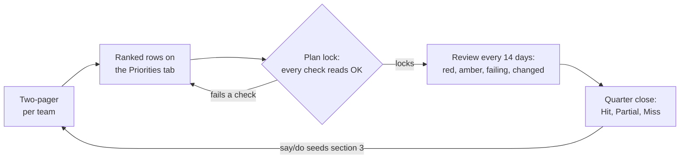

## If you read nothing else

- Every team ranks three to five priorities for the quarter, written as outcomes with a metric, sized to fit inside 70% of its capacity, and entered on the Priorities tab of the [tracker](/handbook/engineering/data-engineering/priorities-tracker/). If it is not on that tab, it is not a commitment.
- Committed rows are planned at 80% confidence, or 90% only when there are no unknowns. There is no 100%. Everything else is aspirational.
- Every row has one owner, links to a ranked org bet, names its dependencies by row and by the person who accepted them, and carries a stop signal with a check-by date.
- Every fourteen days we review for twenty minutes. Red rows leave unblocked, swapped or deprioritized, and a review with nothing to decide is canceled.
- At quarter close every row is scored Hit, Partial or Miss, and a healthy committed hit rate lands between 80% and 90%.

## High-level summary of the process

Every quarter, each EM writes down three to five ranked priorities, sizes them against a capacity ceiling, and commits to them in one place: the priorities tracker. For thirteen weeks we review those rows every fourteen days, and at quarter close we score every one of them.

This page is the org-level layer under GitLab's company planning process for Search and Data Platform. The company process decides the top priorities; this page defines how our teams turn them into ranked, honestly sized bets, run them, and learn from them.

The Priorities tab of the tracker is the plan. If a piece of work is not on that tab, it is not a commitment. The epic is where the work lives; the tracker is where the promise lives.

What this page is not:

- **Not an iteration or milestone process.** Sprint-level planning stays with each team.
- **Not a second status report.** Day-to-day status lives on the epic. The tracker asks one question every fourteen days: is the promise still true?

Every rule on this page has to earn its place by helping a team decide something faster, or with less ceremony. If one does not, open a merge request to remove it.

## Principles

How much process a piece of work deserves depends on how much can go wrong and how uncertain we are about it. A cross-team bet with an external date warrants more structure than a single-team improvement. The principles below apply that idea.

1. **Rank each bet.** Every team ranks its rows 1 to n, the tracker owner ranks the org bets, and capacity follows the rank. See [Prioritizing across teams](#prioritizing-across-teams).
1. **Outcomes, not outputs.** "Ship X" is a task. "By [date], [who] does [what], measured by [metric]" is a bet. Every row carries an outcome, a metric, a baseline and a target.
1. **Capacity is a hard input.** Committed work fits inside 70% of a team's capacity. The other 30% is the reserve: keep-the-lights-on work (KTLO), incidents, on-call and the asks we already know are coming. A plan that fills 100% of capacity does not survive the first incident.
1. **One owner per row, and one org bet.** Every row names one owner and links to an org bet, or says `None`. Committed work linked to no bet is the first candidate to cut.
1. **Say no out loud.** Every plan carries an explicit list of what we are not doing this quarter, who asked, and what we told them. Saying no on the team's behalf, in writing, is one of the most useful things this process does for engineers.
1. **Dependencies are commitments.** A dependency counts only when the providing team has accepted it by name.
1. **Every row knows when to stop, and stopping is a decision.** Each row is written with a stop signal and a check-by date, so the call to deprioritize it can be made in week 4 instead of arriving as a surprise in week 12. Stopping early, with the reasons written down, counts as a good outcome.
1. **Reviews produce decisions or get canceled.** Every red row leaves the review unblocked with a path to green, swapped, or deprioritized. A red row is never carried to the next review just to be watched.

## How this fits GitLab's company process

Two company processes sit above this page. It is designed to fit under them, not to duplicate them.

**The GitLab Operating Model.** Company objectives, e-group metrics and functional-leader initiatives are tracked as three levels of epics with fiscal-quarter labels such as `FY27-Q4`. Source: [GitLab Operating Model](https://internal.gitlab.com/handbook/company/gitlab-operating-model) (internal handbook).

**The R&D Interlock.** The [R&D Interlock](/handbook/product-development/how-we-work/r-and-d-interlock/) aligns Product, UX and Engineering on the few large, cross-functional items each quarter. It defines the priority tiers (P1/E1 at 100% engineering confidence, P2/E2 at 80%, P3/E3 at 50%).

The interlock decides the top of the funnel and stops at commitment. This page covers what happens after: how a team picks and sizes its own rows, **how dependencies get settled, and how committed work is run and closed.**

**What we don't duplicate.** There is no second roadmap and no second priority scheme. The epic already answers how the work is going this week, through its health label and Friday snippet. The tracker asks a different question every fourteen days: is the promise still on track, judged by the metric's current value. When a company artifact already holds a fact, we link to it instead of copying it.

## The tracker

The [priorities tracker](https://docs.google.com/spreadsheets/d/1KsFyxZg3qT7BQMBGJd_qDde6MG2GEsy4tpwPf-u8I1U/edit) (internal, GitLab team members only) is one spreadsheet per quarter. It holds the org bets, the Priorities tab that is the plan, each team's capacity, the Two-pager template and the review log, and it computes the review agenda and the say/do score. The [Priorities tracker guide](/handbook/engineering/data-engineering/priorities-tracker/) explains every tab, how to write a row, the capacity arithmetic and the checks a row must pass before plan lock.

## The cycle

1. **Before the quarter.** Each EM copies the Two-pager template tab, renames it to the team, and fills the yellow cells. Two printed pages, no more. The PM co-signs the outcomes and metrics.
1. **Rows.** The EM enters the team's ranked priorities on the Priorities tab, one row per priority, three to five rows per team.
1. **Plan lock.** On the plan lock date, every row reads `OK` in the [Checks column](/handbook/engineering/data-engineering/priorities-tracker/#checks-the-tracker-enforces), every team fits inside its ceiling on the Capacity tab, and every dependency has a name against it. A row that fails a check does not lock. After plan lock the [swap rule](#swap-and-deprioritize-rules) applies.
1. **Every fourteen days.** EMs update their rows by noon on the Friday of the review, and the review itself takes twenty minutes: red rows first, then amber, then rows failing a check, then rows changed since the last review. A review with nothing to decide is canceled and logged. The details are under Running the quarter, below.
1. **Quarter close.** Every row is scored Hit, Partial or Miss, every committed row gets three close-out lines, and the say/do score seeds next quarter's Two-pagers. The details are under Quarter close and say/do, below.

### Quarter calendar

We plan on calendar quarters: January to March, April to June, July to September, and October to December. Each quarter is thirteen weeks. Plan lock is the Friday of the quarter's first full week, so Two-pagers are due the Friday before, and the calibration review happens in that same week. Reviews run every fourteen days from plan lock, which puts them on the Fridays of the odd weeks and keeps them clear of Thanksgiving, Christmas and New Year. If a review still falls on a company holiday, the tracker owner cancels it in advance and logs it on the Review log, and the first review after the break re-baselines every check-by date.

Two dates in every quarter carry extra meaning. GitLab's fiscal quarters start on Feb 1, May 1, Aug 1 and Nov 1, one month into each calendar quarter, so the first review after that date is where company OKR, budget or headcount changes enter the plan, and they enter by swap, never by addition. The quarter's end date is the scoring date, not a shipping date; in the October to December quarter, Dec 18 is the last day anything ships, and a committed outcome dated Dec 31 has to be true by then.

| Review | When | Milestone |
|---|---|---|
| Two-pagers due | The Friday before plan lock | Every team's Two-pager is in, with rows entered on the Priorities tab |
| Calibration | The week before plan lock | Portfolio review: rank the org bets, challenge inflated confidence, settle rows that do not fit their team's ceiling |
| 1 | Friday of week 1 | Plan lock. Every row reads `OK`, every team is inside its ceiling, every dependency is accepted |
| 2 | Week 3 | Regular review. Anything the interlock changed after plan lock arrives as a swap |
| 3 | Week 5 | Month-1 re-plan and company-change intake: promote aspirational rows into freed capacity, deprioritize lost causes, take in fiscal-quarter changes by swap |
| 4 | Week 7 | Regular review |
| 5 | Week 9 | Regular review |
| 6 | Week 11 | Regular review |
| 7 | Week 13 | Final review, where the quarter has one |
| Close | Last day of the quarter | Score every row, three lines per committed row, record reserve used, seed next quarter's Two-pagers |

## Who does what

Every row has one owner. Every team has one EM and one PM accountable for its plan; where no PM is assigned, the EM covers that role.

| Role | Before plan lock | During the quarter | At quarter close |
|---|---|---|---|
| **Tracker owner** (the org's engineering leader, currently Saurabh Chopra) | Writes and ranks the Org bets tab and sets an appetite per bet. Writes the org-level not-doing list. Runs the calibration review. Sets the quarter settings. Locks the plan | Runs the 20-minute review. Agrees every swap or deprioritization of a committed row | Signs the say/do score. Adjusts next quarter's ceiling from reserve actually used |
| **Engineering manager** | Writes the team's [Two-pager](/handbook/engineering/data-engineering/priorities-tracker/#the-two-pager). Enters and ranks the rows. Confirms engineer counts and absences on the Capacity tab. Gets every dependency accepted by name | Updates Current value, Status, Last update and Change log every cycle. Starts, stops and reorders aspirational rows. Proposes swaps. Protects the reserve | Scores the team's rows. Records reserve actually used. Writes section 3 of the next Two-pager |
| **Product manager** | Co-signs outcomes, metrics, baselines and targets (Two-pager sections 3 and 4). Opens interlock epics for P-track items | Owns the "explicitly not doing" conversations with stakeholders. Decides scope trades inside a row | Confirms the Final value against the metric |
| **Row owner** (one name, an engineer or the EM) | Writes the outcome, stop signal and check-by date for the row | Keeps the epic current. Says when the stop signal fires rather than waiting for the review | Writes the three close-out lines |

Decisions stay with the closest person who can carry the result: the row owner trades scope, the EM trades aspirational rows inside a team, the tracker owner trades committed rows across teams, and only interlocked commitments leave the org.

## Prioritizing across teams

Team rank only orders work inside one team. It cannot tell you whether one team's top row matters more to the org than another team's third. The rules below settle that without inventing a second priority scheme. Capacity and ceilings are defined in the [tracker guide](/handbook/engineering/data-engineering/priorities-tracker/#capacity-and-the-committed-ceiling).

**Org priority comes from the org bets.** The tracker owner ranks the org bets, B1 above B2 above B3, and sets an appetite for each: how many engineer-weeks the org is willing to spend on that bet this quarter. A row's org priority is its bet's rank, then its team rank. Rows linked to `None` sort last. There is no separate cross-team priority label. The priority a team assigns to its own work carries no weight against another team's rows; only the bet ranking does.

**Confidence and importance are different things.** The interlock's P1 and P2, and the tracker's 90% and 80%, describe how sure we are of delivery, not how much the work matters. A team whose rows all sit at 80% is not a lower priority than a team with a 90% row. Cross-team decisions use org priority; confidence only determines the tier.

**The calibration review.** In the week before plan lock, the tracker owner, EMs and PMs spend forty-five minutes on the Priorities tab sorted by org priority. The review answers three questions: is any team's confidence inflated, is any bet over its appetite or starved, and which rows above the line do not fit their team's ceiling. Decisions are logged on the rows. It is the only meeting where cross-team trade-offs get made, and it happens once a quarter.

**The rebalancing ladder.** When a row with high org priority does not fit its team's ceiling, the tracker owner works down this list and stops at the first rung that works: descope the row to fit; swap it in for a lower row on the same team; move the row to a team with headroom and the right skills; lend an engineer for the quarter, recorded on the Capacity tab as an absence for the lending team and capacity for the borrowing team; make it aspirational; defer it. Asking the team to absorb the extra work is deliberately not on the list. That is how the reserve gets used up before the first incident arrives.

**A dependency inherits its consumer's priority.** If a row on one team is what a higher-priority row on another team depends on, it carries that higher priority, and the Checks column flags the inversion until the supplying team re-ranks it.

## Tiers, confidence and status

### Tiers and confidence

Every row is either committed or aspirational, and the whole quarter's committed work fits inside the ceiling.

| Tier | Confidence | Meaning |
|---|---|---|
| Committed | 80% | The default for committed rows. Plan around it; we will be judged on it |
| Committed | 90% | We have done this before and there are no unknowns. Use sparingly. This is where interlocked P1/E1 items sit |
| Aspirational | 50% | A real bet, started only when committed work is on track. The EM can start, stop or reorder it with one Change log line |

The tracker has no 100% option. In practice a 100% commitment means either the estimate is padded or a risk is being ignored. If nobody is willing to put 80% behind a row, it is aspirational, however important it feels.

Interlocked items map onto these tiers rather than adding a fourth. A P1 or E1 item is a 100% commitment to the company and is planned inside the tracker as a 90% row, the tracker's top tier: the 100% is the promise we make outward, the 90% is the forecast we plan around. P2 and E2 items are 80% rows, and P3 and E3 items are aspirational at 50%.

### What status means

| Status | Meaning |
|---|---|
| **On track** (green) | The metric is moving toward target and nothing in the stop signal has fired |
| **At risk** (amber) | Something slipped and the Change log shows a recovery plan with a date. Amber without a plan is red |
| **Off track** (red) | The stop signal fired, a dependency slipped past its date, or there is no credible recovery plan. Red must be resolved at the next review: unblocked, swapped or deprioritized |
| **Done** | Target met and verified by the metric, not by the demo |
| **Deprioritized** | Stopped on purpose, with three lines in the Change log: what we believed, what we learned, what we do instead |

## Running the quarter

The quarter runs on two rhythms: the weekly epic updates the company process already requires, and a 20-minute review every fourteen days.

**Every week, on the epic.** Owners of interlock and operating-model epics keep doing what those processes ask: the `health::` label and the Friday status snippet. None of that gets copied into the tracker.

**Every fourteen days, on the tracker.** By noon on the Friday of the review, each EM updates Current value, Status, Last update and Change log on the team's rows. Then the review, in this order:

1. **Red rows.** Each one leaves the review unblocked, swapped or deprioritized. The decision is made in the review, not afterwards in a thread.
1. **Amber rows.** Is there a dated recovery plan in the Change log? Amber without a plan becomes red.
1. **Rows failing a check.** A check-by date has passed and a decision is owed; a dependency nobody accepted; a row nobody has updated inside the stale window.
1. **Rows changed since the last review.**

The Summary tab produces this agenda and the counts, so no one prepares it by hand. A review with nothing red, nothing amber and nothing changed is canceled, and the Review log gets one line saying so. The counts seen at each review are typed into the Review log so it remains a record, while the Summary tab always shows today's numbers.

**Month-1 re-plan.** The first review after week 4, review 3 in the calendar above, is the explicit re-plan point. It is also the first review after the fiscal quarter boundary, so company changes land here and enter by swap. Aspirational rows can be promoted into freed committed capacity, committed rows that have lost their reason can be deprioritized with a written lesson, and the not-doing list can grow. The one thing that cannot happen here is a slip nobody wrote down.

**After a holiday break.** The first review after the break re-baselines every check-by date.

**What we deliberately do not do.** We do not hold a weekly status meeting, report status in Slack threads or slides, or run a separate program review for single-team rows.

## Swap and deprioritize rules

Plans change mid-quarter, and that is expected. Changing them quietly is not.

1. **Aspirational rows** can be started, stopped or reordered by the EM with one Change log line. No approval.
1. **Adding a committed row after plan lock** means removing one of equal or larger appetite from the same team, with a dated Change log line on both rows and the tracker owner's agreement.
1. **Changing an interlocked commitment** in timeline, scope, cost, priority, quality or risk also goes through the company's [Commitment Change Request](/handbook/product-development/how-we-work/r-and-d-interlock/#commitment-change-requests). If in doubt whether a change is material, it is.
1. **Deprioritizing a row** is a decision, not a failure. Do it early. The stop signal exists so the call can be made in week 4, while there is still time to redirect the capacity. The owner writes three lines in the Change log (what we believed, what we learned, what we do instead), the status moves to Deprioritized, and the review says so when it was a good call.

A useful test for any change: could someone reading the Change log at quarter close work out what changed, when, who decided, and why? If not, the change is not finished.

## Quarter close and say/do

Quarter close scores the quarter against what we said at plan lock. We write the score down before the retrospective, so the retro can spend its time on causes instead of arguing about the numbers.

1. Every row gets a Final value and a result: Hit, Partial or Miss.
1. Every committed row gets three lines: what we believed, what we learned, what we do next.
1. Every EM records reserve actually used against the planned 30%.
1. The Summary tab computes say/do for the org and the Capacity tab computes it per team.
1. Each team carries its say/do and its three lines into section 3 of next quarter's Two-pager.

How to read the score:

| Measure | Target | What a miss means |
|---|---|---|
| Committed hit rate (say/do) | 80% to 90% | Below 70% means the planning was off. 100% while aspirational rows sat untouched means the bar was set too low |
| Aspirational hit rate | About 50% | If a team hits everything aspirational, its committed bar was too low |
| Rows deprioritized on purpose | Some, and early | Deprioritized in week 4 is a good sign. Deprioritized in week 12 is not |
| Reserve actually used | About 30% | If used is more than planned, lower next quarter's ceiling rather than lecturing the team |

## Confidentiality

This page describes the process and is public. The numbers behind it are not. Capacity, engineer counts, customer and design-partner names, and ARR stay in the tracker, which is visible to GitLab team members only, or in an [internal note](https://docs.gitlab.com/user/discussions/#add-an-internal-note) on the epic, following the [SAFE framework](/handbook/legal/safe-framework/) and the interlock page's guidance. If the implementation itself must be private, make the epic confidential.

## Related pages

[Priorities tracker guide](/handbook/engineering/data-engineering/priorities-tracker/), [R&D Interlock](/handbook/product-development/how-we-work/r-and-d-interlock/), [GitLab Operating Model](https://internal.gitlab.com/handbook/company/gitlab-operating-model) (internal), [Data Team planning process](/handbook/enterprise-data/how-we-work/planning/), [GitLab Dedicated quarterly planning](/handbook/engineering/infrastructure-platforms/gitlab-dedicated/environment-automation/#quarterly-planning-process), and [Pre-mortems for launches](/handbook/engineering/data-engineering/pre-mortems/).
