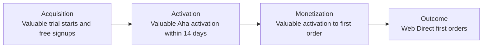

## Mission

Growth turns GitLab's self-serve funnel into a reliable, compounding source of new paid customers by removing what stops people from buying, rather than by generating more traffic.

Our north star is **Web Direct first orders across GitLab.com and self-managed**. A Web Direct first order is a [first order](https://internal.gitlab.com/handbook/enterprise-data/data-governance/data-guides/gtm-operating-performance/first-orders/) (GitLab internal) that a customer places through self-service, without sales assistance. We rank work by its impact on first orders, not signups.

Each funnel stage has one input metric that the roadmap is built to move:

Growth owns the in-product path from first visit to first purchase: registration, onboarding, in-product upgrade and purchase entry points, the trial experience, in-product notifications, and [experimentation tooling](/handbook/engineering/development/growth/experimentation/) ([GitLab Experiment (GLEX)](https://docs.gitlab.com/development/experiment_guide/) and the [Experimenator](https://gitlab.com/groups/gitlab-org/-/work_items/22589)). Key partners are Fulfillment, Pricing, Digital Experience, Lifecycle Marketing, and Enterprise Analytics.

For Growth's principles, metrics, ownership, and current priorities, see the [Growth direction page](/handbook/product/groups/growth/direction/) and [how the growth section works](/handbook/product/groups/growth/).

## How We Work

Working inline with our values, we focus on iteration and collaboration, working with and across areas of the product our development department counterparts maintain.

We work on the issues prioritized by our product teams including running [experiments](/handbook/engineering/development/growth/experimentation/) on GitLab.com. Growth is one team with one roadmap, and engineers are assigned to the highest-ranked work on the roadmap. Growth engineers are Fullstack Engineers. The reason for this is that Growth needs both Frontend and Backend skill-sets, but as a small team, has optimized for team member efficiency to adopt the Fullstack role.

## Growth Leadership & Teams

### Leadership

| Role | Person |
|------|--------|
| Product Director |  |
| Engineering Director |  |
| Engineering Manager |  |
| Senior Staff Fullstack Engineer |  |
| UX Design Manager |  |

### Product & Design

| Role | Person |
|------|--------|
| Product Managers |  |
| Product Designers | ,  |

### Teams & Communication

Growth uses these Slack channels:

- [#s_growth](https://gitlab.slack.com/channels/s_growth) - the main Growth channel
- [#sd_growth_engineering](https://gitlab.slack.com/channels/sd_growth_engineering) - Growth engineering discussion

| Team | GitLab Handle |
|------|---------------|
| Growth (All) | `@gitlab-org/growth` |
| Growth engineers | `@gitlab-org/growth/engineers` |

### All Team Members

## Shared Processes

Our teams collaborate using shared processes and tools:

- [Operating Model](operating_model_growth.md) - operating rhythm for growth
- [Milestone Planning, Refinement and Estimation](initiative_refinement_estimation) - continuous refinement process and estimation guidelines
- [Engineering DRI for Large-Scale Initiatives](engineering_dri) - managing complex workstreams and epics
- [Modular Code Guiding Principle](modular_code) - why and how we write modular code by default
- [Technical Exploration Guidelines](technical_spikes) - guidelines for research and spike work
- [Growth Experimentation Guidelines](experimentation) - guidelines for growth experimentations

## Experimentation

Experiment velocity is Growth's top-ranked problem, because it multiplies the impact of all our other work. Growth owns GLEX and the [Experimenator](https://gitlab.com/groups/gitlab-org/-/work_items/22589), our AI-assisted experiment pipeline. Every experiment is read out before we decide whether to ship it. See [Growth experimentation](/handbook/engineering/development/growth/experimentation/) for the process.

## Resources

Some useful links to see how and what we are working on include:

- [Growth direction](/handbook/product/groups/growth/direction/)
- [Growth Epic Kanban board](https://gitlab.com/groups/gitlab-org/-/epic_boards/2079888)
- [Growth Issue Kanban board for development](https://gitlab.com/groups/gitlab-org/-/boards/1392106?&label_name%5B%5D=devops%3A%3Agrowth)
- [Experimentation](experimentation/)
- [GLEX](https://gitlab.com/gitlab-org/ruby/gems/gitlab-experiment)
- [Experiment rollout](https://gitlab.com/groups/gitlab-org/-/boards/1352542?label_name[]=experiment-rollout)

### Team Boards

We track our current work on these boards:

- [Driving First Orders epic board](https://gitlab.com/groups/gitlab-org/-/epic_boards/2079888?label_name[]=Growth%3A%20Driving%20First%20Orders&label_name[]=Next%20Up&label_name[]=section%3A%3Agrowth) - Driving First Orders epics that are next up
- [Feature Work board](https://gitlab.com/groups/gitlab-org/-/boards/11511990) - Driving First Orders feature work in the current milestone
- [Product Foundations board](https://gitlab.com/groups/gitlab-org/-/boards/11512114?or%5Blabel_name%5D%5B%5D=type%3A%3Amaintenance&or%5Blabel_name%5D%5B%5D=type%3A%3Abug&or%5Blabel_name%5D%5B%5D=Category%3AEngineering%20Excellence&or%5Blabel_name%5D%5B%5D=Engineering%20Time&label_name[]=section%3A%3Agrowth&milestone_title=Started) - bugs, tech debt, and Engineering Excellence work in the current milestone

See [work queue boards](initiative_refinement_estimation.md#work-queue-boards) for what belongs on each board.

## Team Days

On occasion we hold virtual team days or meetings to take a break and participate in fun, social activities with our Growth counterparts.

- [FY23-Q2 2022](https://gitlab.com/gitlab-org/growth/team-tasks/-/issues/625)
- [December 2021](https://gitlab.com/gitlab-org/growth/team-tasks/-/issues/522)
- [April 2021](https://gitlab.com/gitlab-org/growth/product/-/issues/1675)
- [September 2020](https://gitlab.com/gitlab-org/growth/team-tasks/-/issues/175)
- [May 2020](https://gitlab.com/gitlab-org/growth/team-tasks/-/issues/119)

## Common Links

- [Growth stage](/handbook/engineering/development/growth/)
- [Growth workflow board](https://gitlab.com/groups/gitlab-org/-/boards/4152639)
- `#s_growth` in [Slack](https://gitlab.slack.com/archives/s_growth) (GitLab internal)
- [Growth opportunities](https://gitlab.com/gitlab-org/growth/product/-/issues)
- [Growth meetings and agendas](https://drive.google.com/drive/search?q=type:document%20title:%22Growth%20Weekly%22) (GitLab internal)
- GitLab values

## CustomersDot Trials Collaboration

For information about trials ownership and collaborating with the Fulfillment/Monetization team on trials work, see our [Trials Ownership and Collaboration Framework](trials-ownership.md). This framework defines the conceptual ownership model — Growth owns trial entry points; Fulfillment/Monetization owns the deeper trial codebase and all CustomersDot support — along with the decision framework and escalation paths for priority conflicts.
