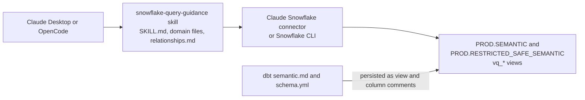
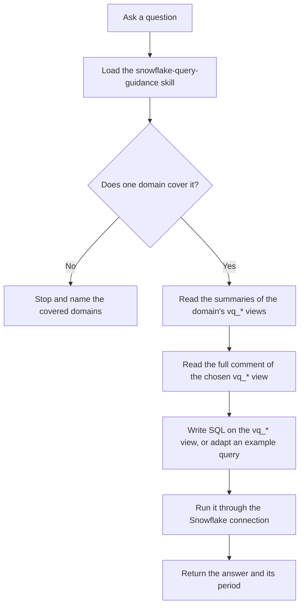

## Purpose

The AI Context Layer lets team members ask business questions in plain language, from AI tools such as Claude and OpenCode, and get answers built on governed GitLab data.

A general purpose model does not know GitLab's fiscal calendar, which table holds the governed definition of a metric, or which filters a query must apply. Without that context it guesses, and a confident wrong answer is worse than no answer. The AI Context Layer gives models governed, GitLab specific context so they find the right data and query it the right way.

The Context Layer follows the principle in [AI Vision and Strategy](/handbook/enterprise-data/ai/ai-vision-and-strategy/): AI is an enabler, and data quality and the data foundation come first. Every domain is built on certified data, documented in dbt, and tested before release.

## How it works

### Components

The Context Layer has two components that load together with the agent.

1. **The `snowflake-query-guidance` skill.** A set of Markdown files that explain what GitLab data means and where it lives. The skill gives the model the what and the why.
   1. `SKILL.md` is loaded every time the skill runs. It holds the routing table, the rules that bind every query, and GitLab wide conventions such as the fiscal calendar.
   1. `references/domains/<domain>.md` holds one business area. The model loads only the domain the question needs. See [Available domains](#available-domains).
   1. `references/relationships.md` holds canonical keys and join paths. The model loads it only for cross table questions.
   1. `references/CONTRIBUTING.md` is the authoring contract for contributors. The model does not use it at query time.
1. **The Snowflake connection and the semantic schemas.** Claude uses the Claude Snowflake connector; OpenCode uses the Snowflake CLI. Both run queries as you, with your own Snowflake role. The queries target documented `vq_*` verified query views in `PROD.SEMANTIC` and `PROD.RESTRICTED_SAFE_SEMANTIC`, the [AI Semantic Schemas](/handbook/enterprise-data/platform/edw/#ai-semantic-schemas) in the data warehouse. Each view's Snowflake comment, written in dbt, documents its grain, must apply filters and worked example queries. The views give the model tested examples of how to get the right answer.

The skill source of truth is the [analytics repository](https://gitlab.com/gitlab-data/analytics/-/tree/master/marketplace-sync/snowflake-query-guidance). It syncs automatically to the [`gitlab-com/marketplace`](https://gitlab.com/gitlab-com/marketplace) repository, so make every change in the analytics repository and never edit the marketplace copy.



### Runtime flow

1. A team member asks a question.
1. The agent loads the skill and applies the GitLab wide conventions.
1. The agent routes the question to exactly one domain using the routing table and the domain's `**Scope:**` line. If no domain fits, the agent stops, says the question is outside the documented domains, and names the domains that are covered. It does not browse the warehouse.
1. The agent reads the summaries of the domain's `vq_*` views, then reads the full comment of the one view it picks from `INFORMATION_SCHEMA`.
1. The agent writes SQL on the `vq_*` view, usually by adapting one of the view's example queries, and runs it through the Snowflake connection.
1. The agent returns the answer and states the period each figure covers.

The skill forbids writing SQL against a `vq_*` view whose full comment the agent has not read in the current session. The comment carries the must apply filters, so skipping it is how wrong answers happen. The comment read in `SKILL.md` looks like this:

```sql
SELECT comment FROM PROD.INFORMATION_SCHEMA.TABLES
WHERE table_schema = 'SEMANTIC' AND table_name = 'VQ_A';
```



### Why context lives in dbt view comments

Table and column detail lives in the `vq_*` view comments, not in the skill files.

1. **Progressive disclosure.** The model reads only the view it needs, when it needs it. Loading every table's documentation up front would fill the context window, raise token cost, and lower accuracy, because model performance drops as context grows.
1. **Version control next to the transformation layer.** The comments are written in dbt (`semantic.md` and `schema.yml`) and persisted to Snowflake. A change is reviewed, tested in an MR, and released with the model it describes.
1. **One place to maintain.** Domain files stay short and describe how the business area works at GitLab. Table facts that change with the data model are maintained once, next to that model.
1. **Technical context is treated as data.** Just as a physical product is not complete without its instructions, the information needed to query the data correctly and interpret the result is part of the transformation itself.

### Why thin `SELECT *` views

Each `vq_*` view is usually a thin `SELECT *` over an existing, governed table. Existing tables often already have extensive documentation, but it is not written for AI consumption. A view lets the team write documentation tailored for the model, covering both how to query the data and how to interpret the result, without rebuilding the underlying model or disturbing its existing consumers.

A thin `SELECT *` view is a wrapper and should not slow queries down. When an answer is slow, the cause is usually the context gathering at the start of the conversation or the performance of the underlying table.

### Access and security

1. **Snowflake access is required.** Request it through [Lumos](/handbook/security/corporate/systems/lumos/ar/) and choose the **Analyst** role, or **Analyst Safe** if you need [SAFE](/handbook/enterprise-data/platform/safe-data/) data. Analyst Safe makes you a [designated insider](/handbook/legal/publiccompanyresources/#designated-insiders).
1. **Your Snowflake role controls access, not the skill.** Views in `PROD.RESTRICTED_SAFE_SEMANTIC` hold SAFE and material non public data and are readable only by roles that already have that access. The permissions that govern Snowflake also govern the Context Layer.
1. **Row level security lives in the views.** Where a domain needs row level security, it is built into the `vq_*` view. The skill itself does not filter rows or scope results to your accounts.
1. **Missing access is reported, not worked around.** If your role lacks access to a view, the agent tells you and points you to Lumos. It does not retry with another object.

## Benefits

1. **Accurate, governed answers.** Answers come from certified data and documented definitions, not from a model's guess about GitLab's schema.
1. **One place to maintain metadata.** Business meaning lives in a short domain file; table detail lives in dbt next to the model.
1. **Tested before release.** Every domain ships with test cases that the [Eval Harness](/handbook/enterprise-data/ai/context-layer/add-a-domain/eval-harness/) runs before a change merges.
1. **Regressions are caught in MRs.** A change to one domain is tested against its neighbors, so it does not quietly break answers elsewhere.
1. **Any team can contribute.** Teams add domains for their own business areas while the Analytics Engineering team maintains the shared skill through the analytics repository.

## Available domains

Domains are added and changed through MRs to the analytics repository, so this page does not list them. Check these sources instead.

1. **Domain files.** Each file in [`marketplace-sync/snowflake-query-guidance/references/domains/`](https://gitlab.com/gitlab-data/analytics/-/tree/master/marketplace-sync/snowflake-query-guidance/references/domains) is one domain. Its `**Scope:**` line lists the subjects it covers.
1. **Routing table.** A domain is live only when it has a row in the routing table in [`SKILL.md`](https://gitlab.com/gitlab-data/analytics/-/blob/master/marketplace-sync/snowflake-query-guidance/SKILL.md). A domain file with no routing row is not used.
1. **Test cases.** Each file in [`agents/evals/snowflake_query_guidance/test_cases/`](https://gitlab.com/gitlab-data/analytics/-/tree/master/agents/evals/snowflake_query_guidance/test_cases) holds a domain's test cases. They are also good examples of the questions that domain answers.
1. **Verified query views.** This query lists every `vq_*` view your role can see, with the summary from its comment:

   ```sql
   SELECT table_schema,
          table_name,
          TRIM(SPLIT_PART(comment, '---', 1)) AS summary,
          last_altered
   FROM PROD.INFORMATION_SCHEMA.TABLES
   WHERE table_schema IN ('SEMANTIC', 'RESTRICTED_SAFE_SEMANTIC')
     AND STARTSWITH(table_name, 'VQ_')
   ORDER BY table_schema, table_name;
   ```

   The summary is the text above the `---` separator in the view's comment. It says what the view holds and which questions route to it. To read a view's full documentation, select `comment` for that one view.

You can also ask the agent which domains it covers.

## Ownership and contribution model

1. **The Analytics Engineering team maintains the skill.** The team owns the skill through the analytics repository, including the shared routing surface (`SKILL.md` and `relationships.md`), and reviews every change. Approval comes from a Semantic Layer code owner listed in the analytics repository [`CODEOWNERS`](https://gitlab.com/gitlab-data/analytics/-/blob/master/CODEOWNERS) file.
1. **Anyone can contribute.** Follow the [Add a Domain Guide](/handbook/enterprise-data/ai/context-layer/add-a-domain/) and open the MR with the [`semantic_layer_changes`](https://gitlab.com/gitlab-data/analytics/-/blob/master/.gitlab/merge_request_templates/semantic_layer_changes.md) template.
1. **Shared domains stay shared.** Several teams can contribute to one domain. No domain file belongs to a single team.
1. **Overlap is caught in review.** GitLab Duo reviews every Context Layer MR against the authoring contract and flags a definition that already lives in another domain or view. The routing check in the eval harness shows when a new domain pulls questions away from an existing one.
1. **Definitions have a home.** Business definitions live in the domain file; technical definitions live in the view documentation. The Context Layer is the place to find the governed definition of a metric. When a business team changes a definition, the domain file must be updated through an MR, the same way the handbook is.

## Glossary

| Term | Meaning |
|---|---|
| Context layer | The `snowflake-query-guidance` skill together with the documented `vq_*` views in Snowflake. Contributors extend it by adding domain files and verified query views |
| Domain | One business area the Context Layer can answer questions about. See [Available domains](#available-domains) |
| Domain file (domain guide) | `references/domains/<domain>.md`. Holds the domain's scope, its list of `vq_*` views, vocabulary, exclusions, disambiguation questions and cross view rules |
| Eval harness | The automated test framework in `agents/evals/snowflake_query_guidance/` that runs test cases against the skill and grades the answers |
| Execution accuracy | Whether the agent's SQL returned the same result set as the case's reference query. The headline metric of a full sweep |
| Full sweep | An eval run that grades routing, execution accuracy and judge checks, with three runs per case by default |
| Golden query | A worked, verified SQL query the agent can run or adapt. These live in each view's `## Example Queries` section |
| Judge checks | Written, checkable assertions that an LLM judge scores the answer against. They catch what execution accuracy cannot, such as a refusal or a missing period |
| Reference query | The known correct SQL for a test case. The harness runs it live and compares its result set with the agent's |
| `relationships.md` | The skill file that defines canonical keys, join chains and cardinality facts that cannot be derived from grain |
| Routing | How the agent picks which domain file and which `vq_*` view to read for a question |
| Routing check | A fast eval run that grades only whether the agent opened the right documentation. It runs no answer query |
| `schema.yml` | The dbt file that registers each `vq_*` view and describes every column. Persisted to Snowflake as column comments |
| Semantic schema | `PROD.SEMANTIC` or `PROD.RESTRICTED_SAFE_SEMANTIC`, the governed Snowflake schemas that hold the `vq_*` views. See [AI Semantic Schemas](/handbook/enterprise-data/platform/edw/#ai-semantic-schemas) |
| `semantic.md` doc block | The `` block in dbt that documents one view: summary, use cases, must apply filters, keys, scope rules and example queries. Persisted as the view comment |
| Skill | A packaged set of instructions an agent loads when a task matches it. The Context Layer's skill is `snowflake-query-guidance` |
| `SKILL.md` | The skill's entry file. Holds the routing table, the global rules and the GitLab wide conventions |
| Test case | One question in `test_cases/<domain>.yaml`, with the documentation it should route to, a reference query, judge checks, or both |
| Verified query (VQ, `vq_*`) | A documented view in a semantic schema, named with the `vq_` prefix, that gives the agent a governed, tested path to data |

## Next steps

1. To start asking questions, follow [Context Layer Setup](setup.md).
1. To add a business area, follow the [Add a Domain Guide](/handbook/enterprise-data/ai/context-layer/add-a-domain/).
1. To test a change, see the [Eval Harness](/handbook/enterprise-data/ai/context-layer/add-a-domain/eval-harness/).
